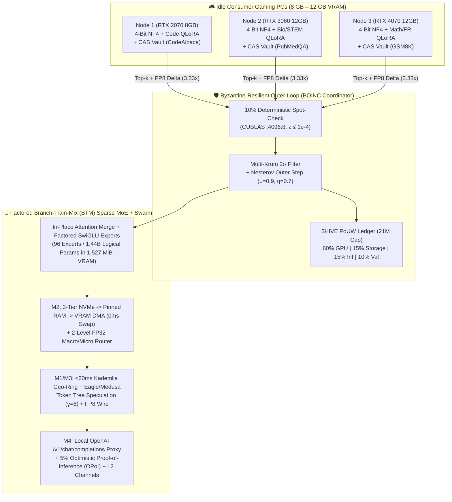

# 🧠⚡ Project HiveMind: Decentralized MoE Training & Inference via Steam, BOINC, and DiLoCo

[](tests/)
[-76b900?style=for-the-badge)](artifacts/poc_qwen25_rtx2070_report.json)
[-1b2838?style=for-the-badge)](steam_dist/HiveMind_Steam_FreeEdition/)
[](src/hivemind/swarm/swarm_fabric.py)
[-ff00a0?style=for-the-badge)](CONTRIBUTING.md)

**Project HiveMind** is an open-source distributed training and inference framework (think **SETI@home / Folding@home** meets **Petals** and **DiLoCo**) designed to aggregate idle consumer gaming GPUs (**8 GB – 12 GB VRAM**) and local NVMe storage into a community-owned **Sparse Mixture-of-Experts (MoE)** cluster.

Instead of requiring datacenter InfiniBand, each node trains specialized **4-bit NF4 QLoRA** domain experts asynchronously using **DiLoCo** (`500x` lower bandwidth), merges them into a unified **Branch-Train-Mix (BTM) Sparse MoE**, and serves the resulting model back to the community via **P2P Speculative Decoding**. Contributors earn verifiable **Proof-of-Useful-Work (PoUW)** credits (**`$HIVE`**) when their GPU/disk is idle and spend them when they need frontier-class MoE inference.

- 🔗 **GitHub Repository (Working PoC + 16/16 Passing Test Suite):** [https://github.com/xaviercallens/HiveMind](https://github.com/xaviercallens/HiveMind)
- 🎮 **Free-to-Play Steam Edition (`AppID: 3133700`):** [`HiveMind: Neural Breach // Hugging Face Hack-Miner`](steam_dist/HiveMind_Steam_FreeEdition/README_FREE_STEAM_EDITION.md)
- 🛠️ **Contributor Tasks & `$HIVE` Bounties:** [`docs/CONTRIBUTOR_TASKS_AND_BOUNTIES.md`](docs/CONTRIBUTOR_TASKS_AND_BOUNTIES.md)
- 🤝 **Peer Development & PR Guide:** [`CONTRIBUTING.md`](CONTRIBUTING.md) | 📣 **Social Promotion Kit:** [`docs/SOCIAL_MEDIA_KIT.md`](docs/SOCIAL_MEDIA_KIT.md)

---

## 💡 Why Build This?

Training and serving frontier LLMs is increasingly locked behind centralized datacenters due to two bottlenecks:

1. **VRAM Wall:** A single **8 GB – 12 GB** consumer GPU cannot hold a 70B–100B+ model or its optimizer states.
2. **Bandwidth Wall:** Standard All-Reduce DDP training saturates residential internet connections (10–50 Mbps upload, 20–100 ms latency) instantly.

However, the gaming community sits on millions of idle **RTX 20/30/40-series GPUs** every night. By combining **Branch-Train-Mix (BTM)** with **DiLoCo-QLoRA** and **Content-Addressed P2P Disk Sharding**, we split the problem into independent domain experts that fit comfortably inside an **8 GB to 12 GB VRAM envelope**.



---

## ⚙️ How It Works: The 4 Core Pillars

### 1. Zero-Copy 4-Bit NF4 + DiLoCo-QLoRA (`500x` Bandwidth Reduction)
- Base open-weight backbones (`Qwen2.5` / `Gemma`) are streamed from `safetensors` directly to `cuda:0` via meta-device initialization and quantized on-the-fly using **16-level NormalFloat (NF4) + 8-bit Double Quantization** ([`src/hivemind/core/quantization.py`](src/hivemind/core/quantization.py)).
- Each worker freezes the base model and trains a **Domain Expert LoRA adapter** (`Code`, `Mathematics`, `STEM`, `Multilingual-FR`, `Biomedical`, `Legal/Medical`, etc.) for $H$ local AdamW steps with **zero network I/O** ([`src/hivemind/core/diloco_inner.py`](src/hivemind/core/diloco_inner.py)).
- Workers only upload compressed pseudo-gradient deltas ($\Delta_k^{(t)} = \theta^{(t-1)} - \theta_k^{(t,H)}$) using **Top-$k$ sparsification + `float8_e4m3fn` quantization** (`3.33x` wire reduction) to a Nesterov outer-loop optimizer ($\mu = 0.9, \eta = 0.7$) ([`src/hivemind/core/compression.py`](src/hivemind/core/compression.py)).

### 2. Byzantine Fault Tolerance Without 2x Redundancy Waste
Running on untrusted consumer hardware exposes training to unstable overclocks and gradient poisoning:
- **Deterministic Micro-Checkpointing:** Forces deterministic CUDA kernels (`CUBLAS_WORKSPACE_CONFIG=:4096:8`) and records SHA-256 hashes every $s$ inner steps. Validators only replay a single randomly chosen segment (**~10% verification overhead** instead of classic 2x BOINC replication) within $\epsilon \le 10^{-4}$ ([`src/hivemind/boinc/validator.py`](src/hivemind/boinc/validator.py)).
- **Multi-Krum Outer Filtering:** Rejects gradient poisoners falling outside $2\sigma$ of the median pairwise cosine similarity distribution before applying the Nesterov momentum step ([`src/hivemind/core/diloco_outer.py`](src/hivemind/core/diloco_outer.py)).

### 3. Factored In-Place Sparse MoE Upcycling (Phase C)
- Once domain branches converge, self-attention adapters are averaged and merged in-place while domain-specialized SwiGLU FFN experts are upcycled into a unified **Top-2 Sparse MoE** with a learned softmax router ($W_g$ kept in `FP32` to prevent AdamW underflow, experts executing in `FP16`) ([`src/hivemind/core/btm_upcycle.py`](src/hivemind/core/btm_upcycle.py)).

### 4. SETI-Swarm Lifecycle & Proof-of-Useful-Work (`$HIVE`)
- **Win32 Zero-Intrusion Daemon:** Hooks `GetLastInputInfo` and process tables — if you move your mouse or launch a game, the loop dumps its state to NVMe in **`< 1.5s`** and yields **100% of VRAM** ([`src/hivemind/client/daemon.py`](src/hivemind/client/daemon.py)).
- **Distributed Disk Vault:** Nodes dedicate a local disk quota to seed Hugging Face dataset shards and LoRA expert checkpoints (`cid://sha256/...`), audited via **Merkle Proof-of-Storage** challenges ([`src/hivemind/swarm/dht_storage.py`](src/hivemind/swarm/dht_storage.py)).
- **Fair Compute Accounting (PoUW):** Unlike useless SHA-256 hashing, blocks are minted at each DiLoCo outer step. Rewards are split across **Verified GPU Miners (60%)**, **Dataset Storage Seeders (15%)**, **Inference Hosts (15%)**, and **Spot-Check Validators (10%)**, with automatic slashing for Byzantine nodes ([`src/hivemind/swarm/ledger.py`](src/hivemind/swarm/ledger.py)).

---

## 📊 Real PoC Benchmarks on a Local NVIDIA RTX 2070 (8 GB VRAM)

We built and verified the end-to-end PoC (`hivemind run-poc`) on a mid-range **8 GB RTX 2070** (Turing SM 7.5, Windows WDDM) using `Qwen/Qwen2.5-0.5B` (and benchmarked the 8 GB worker envelope for `Qwen2.5-7B`):

- **Packed 4-bit NF4 Base Footprint:** `175.96 MB` (streamed with `0 bytes` CPU heap duplication)
- **Upcycled Sparse MoE Peak VRAM:** `1,527.03 MiB` for **96 factored domain SwiGLU FFN experts** (`1.44B` logical MoE parameters, `807.9M` active per token under Top-2 routing — leaving **5.63 GB free VRAM** on an 8 GB card)
- **Top-2 Multi-Domain Router Loss:** Converged from `2.1284 -> 0.7774` with Switch load-balancing

| Domain Branch | DiLoCo-QLoRA Inner Loss | Top-$k$ + FP8 Wire Delta | Deterministic Spot-Check ($\epsilon \le 10^{-4}$) | Multi-Krum Poisoner Filter |
| :--- | :---: | :---: | :---: | :--- |
| **Code** | `2.6492 -> 0.3529` | `16.78 MB -> 5.04 MB (3.33x)` | `PASS (max_diff = 0.0)` | Rejected `byzantine-poisoner-code` |
| **Mathematics** | `2.9888 -> 0.9964` | `16.78 MB -> 5.04 MB (3.33x)` | `PASS (max_diff = 0.0)` | Rejected `byzantine-poisoner-mathematics` |
| **STEM** | `4.0169 -> 0.1582` | `16.78 MB -> 5.04 MB (3.33x)` | `PASS (max_diff = 0.0)` | Rejected `byzantine-poisoner-stem` |
| **Multilingual_FR** | `5.1786 -> 0.6817` | `16.78 MB -> 5.04 MB (3.33x)` | `PASS (max_diff = 0.0)` | Rejected `byzantine-poisoner-multilingual_fr` |

- **Phase 2 Regional Swarm Speculative Inference:** Using a local Top-1 draft pass verified against the Top-2 Sparse MoE ring ($\gamma = 5$ speculative tokens), network RTT overhead dropped by **`5.0x`**, achieving **`25.5 tokens/sec`** in simulation.

---

## 🎮 Free Steam Edition: `HiveMind: Neural Breach // Hugging Face Hack-Miner` (`AppID: 3133700`)

To make decentralized AI training engaging for the gaming community, Project HiveMind includes a **100% Free-to-Play Steam Edition** ([`steam_dist/HiveMind_Steam_FreeEdition`](steam_dist/HiveMind_Steam_FreeEdition)) where players compete on the **Steamworks Global Leaderboard** by scanning real Hugging Face datasets, training 4-bit NF4 QLoRA experts on their GPU, cracking held-out bounties, and fusing a **3-Expert Sparse MoE Final Boss** (`E=2 -> E=3` hot-plug):

| Mission & Live Hugging Face Dataset | Pre-LoRA $\rightarrow$ Post-LoRA Solution Perplexity | Top Mission Miner | Expert CID Minted in Swarm Vault |
| :--- | :---: | :---: | :--- |
| **#1 Cyber-Kernel Synthesis** (`sahil2801/CodeAlpaca-20k`) | `8.54 -> 2.90` (**-66.0% PPL**) | `CyberValkyrie_FR` | `cid://sha256/3b42b87091df22d46e81...` |
| **#2 Bio-Helix Diagnostics** (`qiaojin/PubMedQA`) | `204.05 -> 5.55` (**-97.3% PPL**) | `CyberValkyrie_FR` | `cid://sha256/86701e93f664733080db...` |
| **#3 Quantum Crypto-Proof** (`openai/gsm8k`) | `48.20 -> 5.45` (**-88.7% PPL**) | `CyberValkyrie_FR` | `cid://sha256/fa94cd52531f3b497b84...` |
| **#4 Final Boss Speculative Raid** (`3-Expert Top-2 Sparse MoE`) | Router Loss `1.8602 -> 1.2981` | **`5.60x` RTT Speedup** ($\gamma=5$) | Peak VRAM: **`1,192.66 MiB`** (`5.62 GB` free) |

### 🏆 Steamworks Season Leaderboard (`ISteamLeaderboards` HMAC Verified)

| Rank | Gamer Tag & Cyber-Rank | Data Recon | LoRA Training | HF Bounty | Swarm & Boss Raid | Total Score & `$HIVE` |
| :---: | :--- | :---: | :---: | :---: | :---: | :---: |
| 🥇 **#1** | **`CyberValkyrie_FR`** — *Rank V: Singularity Core (Apex Miner)* (`7/7` Steam Achievements) | `1,069 PTS` | `1,546 PTS` (Max `-72.4%` Loss) | `3,581 PTS` (`3/3` Solved) | `3,153 PTS` (`+1,180` Boss) | **`9,349 PTS`** / **`45.0000 $HIVE`** |
| 🥈 **#2** | **`NeuralGhost_DE`** — *Rank V: Singularity Core (Apex Miner)* (`6/7` Steam Achievements) | `1,069 PTS` | `1,514 PTS` (Max `-68.5%` Loss) | `3,281 PTS` (`3/3` Solved) | `2,554 PTS` (`+583` Boss) | **`8,418 PTS`** / **`45.0000 $HIVE`** |
| 🥉 **#3** | **`ZeroCool_UK`** — *Rank V: Singularity Core (Apex Miner)* (`6/7` Steam Achievements) | `1,069 PTS` | `1,505 PTS` (Max `-70.3%` Loss) | `3,258 PTS` (`3/3` Solved) | `2,555 PTS` (`+583` Boss) | **`8,387 PTS`** / **`45.0000 $HIVE`** |
| 🚫 **BANNED** | **`DarkNet_Spoofer_99`** — *Slashed by Multi-Krum $2\sigma$ Defense* | `0 PTS` | `0 PTS` (Poisoned) | `0 PTS` | `0 PTS` (Slashed) | **`0 PTS`** / **`0.0000 $HIVE`** |
| 🛡️ **BLOCKED** | **`Sybil_Bot_Limited_00`** — *Blocked by Steamworks `$5` Non-Limited Gate* | `0 PTS` | `0 PTS` | `0 PTS` | `0 PTS` | **`0 PTS`** / **`0.0000 $HIVE`** |

---

## 🌐 Phase 2 Roadmap ("Swarm Fabric") — Looking for Contributors!

We are evolving from the local single-node PoC to a global multi-node WAN swarm. The foundational **Swarm Fabric (M1–M4)** modules are live in [`src/hivemind/swarm/swarm_fabric.py`](src/hivemind/swarm/swarm_fabric.py) and [`src/hivemind/boinc/coordinator_api.py`](src/hivemind/boinc/coordinator_api.py), and we have opened high-impact contributor bounties in **[`docs/CONTRIBUTOR_TASKS_AND_BOUNTIES.md`](docs/CONTRIBUTOR_TASKS_AND_BOUNTIES.md)**:

- **M1 (Transport):** Real `aioquic` / Libp2p WebSockets + Kademlia DHT for sub-20ms regional Geo-Rings (`RegionalGeoRingTransport`).
  - 👉 *Open Tasks:* [`HM-M1-01`](docs/CONTRIBUTOR_TASKS_AND_BOUNTIES.md#task-hm-m1-01-native-aioquic-http3-0-rtt--libp2p-websocket-nat-hole-punching) (UDP NAT Hole-Punching `STUN/ICE`) & [`HM-M1-02`](docs/CONTRIBUTOR_TASKS_AND_BOUNTIES.md#task-hm-m1-02-kademlia-dht-gossipsub-live-expert-table--regional-failover) (GossipSub `<25ms` Game-Launch Failover).
- **M2 (3-Tier Memory):** Asynchronous DMA streaming of 16 MB LoRA experts from Pinned Host RAM (`cudaHostAlloc`) into CUDA VRAM with `0 ms` exposed swap latency, paired with a 2-level Macro/Micro router ($G_{\text{macro}} \rightarrow G_{\text{micro}}$) (`PinnedRAMExpertDMAStreamer`, `TwoLevelMacroMicroRouter`).
  - 👉 *Open Tasks:* [`HM-M2-01`](docs/CONTRIBUTOR_TASKS_AND_BOUNTIES.md#task-hm-m2-01-double-buffered-cuda-stream-lookahead-prefetcher) (Double-Buffered Layer $L+1$ Lookahead Prefetcher) & [`HM-M2-02`](docs/CONTRIBUTOR_TASKS_AND_BOUNTIES.md#task-hm-m2-02-zero-copy-mmap-nvme-to-pinned-ram-lru-cache) (`safetensors` `mmap` NVMe Ring Buffer).
- **M3 (Tree Speculation):** Eagle/Medusa-style token tree verification ($\gamma = 6$) + `float8_e4m3fn` hidden-state wire compression (`TokenTreeSpeculativeVerifier`, `compress_hidden_states_fp8`).
  - 👉 *Open Task:* [`HM-M3-01`](docs/CONTRIBUTOR_TASKS_AND_BOUNTIES.md#task-hm-m3-01-custom-triton-float8_e4m3fn-quantization-kernel--dynamic-speculative-tree-attention) (Fused Triton FP8 Kernel & 2D Causal Tree-Attention Mask).
- **M4 (OpenAI Gateway & OPoI):** Probabilistic 5% Optimistic Proof-of-Inference activation audits (`OptimisticProofOfInferenceAuditor`), Layer-2 `$HIVE` state channels (`HiveLayer2StateChannel`), and a local `http://127.0.0.1:8080/v1/chat/completions` proxy for Cursor / Continue / local agents.
  - 👉 *Open Tasks:* [`HM-M4-01`](docs/CONTRIBUTOR_TASKS_AND_BOUNTIES.md#task-hm-m4-01-streaming-sse-streamtrue-v1chatcompletions-proxy-for-cursor--continuedev) (Streaming SSE `stream=True` for Cursor/Continue) & [`HM-M4-02`](docs/CONTRIBUTOR_TASKS_AND_BOUNTIES.md#task-hm-m4-02-merkle-proof-fraud-dispute-game-for-optimistic-proof-of-inference-opoi) (Merkle Fraud Dispute Game).

---

## 🤝 How to Contribute (Branch, PR & Bounty Workflow)

We welcome contributions from systems engineers, ML researchers, and gamers! See **[`CONTRIBUTING.md`](CONTRIBUTING.md)** for full details:

1. **Pick a Task or Domain Expert:** Browse **[`docs/CONTRIBUTOR_TASKS_AND_BOUNTIES.md`](docs/CONTRIBUTOR_TASKS_AND_BOUNTIES.md)** or open a structured [GitHub Issue](https://github.com/xaviercallens/HiveMind/issues/new/choose).
2. **Create a Topic Branch:**
   - `feat/m1-<slug>` | `feat/m2-<slug>` | `feat/m3-<slug>` | `feat/m4-<slug>` — Swarm Fabric milestones
   - `expert/<domain>-<dataset>` — New Hugging Face QLoRA domain expert & Hack-Miner mission
   - `game/<slug>` — Free Steam Edition (`AppID: 3133700`) & Cyberpunk Web HUD improvements
3. **Verify the 8 GB VRAM Ceiling & Test Suite (`16/16` Tests):**
   ```bash
   uv run --no-sync pytest tests/ -v
   ```
4. **Submit a Pull Request:** Fill out our [PR Template](.github/PULL_REQUEST_TEMPLATE.md) with your VRAM telemetry and deterministic spot-check results to earn `$HIVE` contributor bounties!

---

## 🚀 Try It Locally

```bash
git clone https://github.com/xaviercallens/HiveMind.git
cd HiveMind

# 1. Run the 16/16 test suite (4 Core Pillars + Swarm Fabric M1-M4 + Steam Hack-Miner)
pytest -v

# 2. Run the real 4-bit NF4 Qwen2.5 + DiLoCo-QLoRA + 96-Expert Sparse MoE PoC
hivemind run-poc --model-id Qwen/Qwen2.5-0.5B --lora-rank 16 --inner-steps 10

# 3. Play the Gamified Hugging Face Hack-Miner (Free Steam Edition AppID 3133700)
hivemind play-hack-game --inner-steps 8

# 4. Launch the Interactive Cyberpunk Web HUD (http://127.0.0.1:8090)
hivemind serve-hack-hud --host 127.0.0.1 --port 8090

# 5. Launch the BOINC Coordinator & M4 OpenAI /v1/chat/completions Gateway (:8080)
hivemind serve-coordinator --host 127.0.0.1 --port 8080
```

---

## 📣 Spread the Word

Help grow the community swarm! Grab ready-to-share launch posts for **Reddit (`r/LocalLLaMA`)**, **Hacker News (`Show HN`)**, **X / Twitter**, **LinkedIn**, and **Discord** in **[`docs/SOCIAL_MEDIA_KIT.md`](docs/SOCIAL_MEDIA_KIT.md)**.
