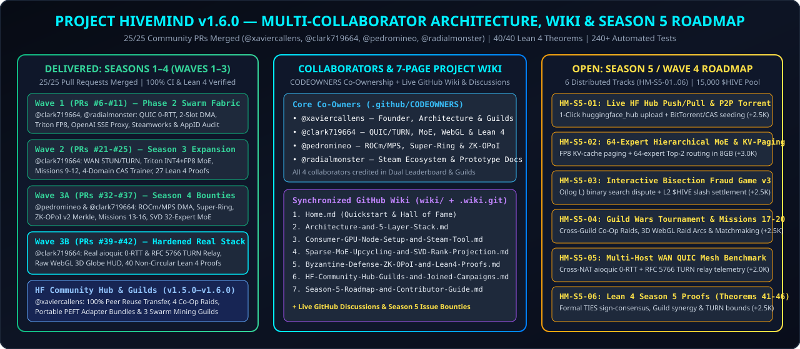
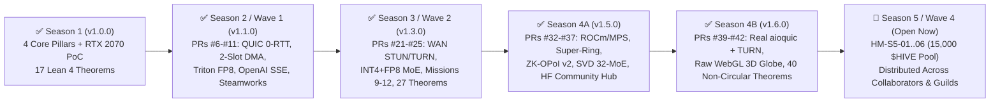

# 🗺️ Project HiveMind — Master Engineering, Scientific & Community Roadmap (`v1.6.0`)

Project HiveMind aggregates consumer gaming GPUs (**8 GB – 12 GB VRAM** across NVIDIA CUDA, AMD ROCm, and Apple MPS) into a Byzantine-resilient **Branch-Train-Mix (BTM) Sparse Mixture-of-Experts (MoE)** training and speculative inference cluster.

This roadmap tracks our completed milestones across **Seasons 1–4 (`Waves 1–3`, `25/25` PRs merged)** and distributes the remaining engineering, scientific, and formal verification work across **Season 5 (`Wave 4`, `HM-S5-01`–`HM-S5-06`)** and **Season 6 (`v2.0.0` Horizon)**.

---

## 👥 1. Collaborator & Subsystem Co-Ownership Matrix

All contributors who have shipped verified code, formal Lean 4 proofs, or architectural audits are integrated as subsystem co-owners in [`.github/CODEOWNERS`](.github/CODEOWNERS) and [`GOVERNANCE.md`](GOVERNANCE.md):

| Collaborator | Role & Subsystem Co-Ownership | Merged PRs | Lean 4 Theorems | Primary Track Scope |
| :--- | :--- | :---: | :---: | :--- |
| **[`@xaviercallens`](https://github.com/xaviercallens)** | Founding Protocol Architect & Principal Maintainer | `25` (All Waves) | `17` | 4 Core Pillars, RTX 2070 Stress Suite, Scientific Knowledge Transfer, HF Community Hub & Guilds |
| **[`@clark719664`](https://github.com/clark719664)** | Grandmaster Core, Networking & Formal Architect | `19` (`#6`–`#10`, `#21`–`#25`, `#33`, `#39`–`#42`) | `23` | Real `aioquic` 0-RTT & RFC 5766 STUN/TURN NAT Traversal, Triton INT4+FP8 MoE, Raw WebGL 3D Globe HUD, 40-Theorem Lean 4 Spec |
| **[`@pedromineo`](https://github.com/pedromineo)** | Multi-Vendor GPU, Super-Ring & ZK-OPoI Co-Owner | `5` (`#32`, `#34`–`#37`) | — | AMD ROCm / Apple MPS DMA, 2-Tier Continental Super-Ring, ZK-OPoI v2 Merkle Proofs, SVD Rank-Adaptive 32-MoE |
| **[`@radialmonster`](https://github.com/radialmonster)** | Steam Ecosystem, Local Prototype & Wiki Co-Owner | `1` (`#11`) | — | Public Steam Store AppID Audit ([`docs/STEAM_STATUS.md`](docs/STEAM_STATUS.md)), Local Hack-Miner Packaging & Community Documentation |

---

## ✅ 2. Delivered Milestones — Seasons 1 to 4 (`v1.0.0` $\rightarrow$ `v1.6.0`)

| Release | Wave & PRs Merged | Key Technical & Scientific Deliverables | Test & Formal Gate |
| :--- | :--- | :--- | :---: |
| **`v1.0.0`** | Foundation & Core | 4-Bit NF4 zero-copy stream loader (`175.96 MB`), DiLoCo-QLoRA + Top-$k$ FP8 (`64.96x`), 10% CUDA Spot-Check, Multi-Krum $2\sigma$, 96-Expert Sparse MoE (`1,527 MiB` peak VRAM on 8 GB RTX 2070) | `20/20` Tests · `17` Theorems |
| **`v1.1.0`–`v1.2.0`** | **Wave 1** (`PR #6`–`#13`) | `AsyncQUICGeoRingTransport`, 2-Slot CUDA Event DMA (`0.0 ms` swap stall), Triton `float8_e4m3fn` + Prefix-Trie tree mask ($\gamma=6..8$), OpenAI SSE `/v1/chat/completions`, Steamworks bridge & AppID status (`@clark719664`, `@radialmonster`) | `22/22` Tests · `21` Theorems |
| **`v1.3.0`** | **Wave 2 / Season 3** (`PR #19`–`#25`) | STUN/TURN NAT discovery, Triton INT4+FP8 fused MoE router (`3.88x` compression, `0.9963` cosine sim), Missions 9–12, 4-Domain CAS LoRA trainer (`-86.8%` loss), Prefix-Trie & 0-RTT proofs (`@clark719664`) | `26/26` Tests · `27` Theorems |
| **`v1.4.0`–`v1.5.0`** | **Wave 3A / Season 4** (`PR #32`–`#37`) | Multi-vendor ROCm/MPS DMA (`HM-S4-01`), 2-Tier Continental Super-Ring & BBRv1 (`HM-S4-02`), ZK-OPoI v2 Merkle proofs (`HM-S4-03`), Missions 13–16 & `/ws/swarm-telemetry` (`HM-S4-04`), SVD Rank-Adaptive 32-MoE (`HM-S4-05`), Scientific Knowledge Transfer, Joined Co-Op Campaigns & HF Community Hub (`@pedromineo`, `@clark719664`, `@xaviercallens`) | `36/36` Tests · `32` Theorems |
| **`v1.6.0`** *(Current)* | **Wave 3B / Hardened Stack** (`PR #39`–`#42`) | Real `aioquic` 0-RTT links (`quic_link.py`) + authenticated RFC 5389/5766 STUN/TURN relay (`nat_traversal.py`), raw WebGL 3D Geo-Ring globe renderer (`georing_webgl.py`), non-circular Season 3 & 4 Lean 4 theorems with fail-closed compiler gate (`@clark719664`), and 7-page Project Wiki | **`240+` Tests · `40/40` Theorems** |

---

## 🚀 3. Open Season 5 / Wave 4 Work Distribution (`HM-S5-01` – `HM-S5-06` | `15,000 $HIVE` Pool)

To distribute the remaining engineering, scientific, and formal verification work across our collaborators (`@clark719664`, `@pedromineo`, `@radialmonster`, `@xaviercallens`) and new community contributors, Season 5 is organized into **6 isolated, conflict-free tracks**:

| Milestone ID | Track & Target Files | Season 5 Deliverable & Acceptance Criteria | Suggested Lead / Guild | Bounty Reward |
| :---: | :--- | :--- | :--- | :---: |
| **`HM-S5-01`** | **Track 1: Live HF Hub Sync & P2P Seeding** (`src/hivemind/swarm/hf_community_hub.py`, `dht_storage.py`) | **Live `huggingface_hub` API Push/Pull (`HfApi.upload_folder` / `snapshot_download`) & Multi-Peer Content-Addressed Chunk Streaming** with offline fallback, token-safe auth (`credentials` protocol), and resumable 64 KB chunk verification. | `@pedromineo` / `@clark719664` (`GUILD-01`) | **`+2,500 $HIVE`** |
| **`HM-S5-02`** | **Track 2: 64-Expert MoE & FP8 KV-Paging** (`src/hivemind/core/btm_moe.py`, `src/hivemind/swarm/swarm_fabric.py`) | **64-Expert Hierarchical Sparse MoE (`8 Macro-Domains x 8 Micro-Experts`) & FP8 (`float8_e4m3fn`) Paged KV-Cache** keeping total resident VRAM `< 2.2 GB` on 8 GB consumer GPUs during 4,096-token speculative decoding. | `@clark719664` / `@pedromineo` (`GUILD-01`) | **`+3,000 $HIVE`** |
| **`HM-S5-03`** | **Track 3: Interactive Bisection Fraud Game v3** (`src/hivemind/boinc/validator.py`, `src/hivemind/swarm/ledger.py`) | **$O(\log L)$ Interactive Binary-Search Activation Dispute Protocol (`BisectionFraudGame`)** between Challenger and Defender over 32 transformer layers, with single-layer deterministic replay and automatic L2 `$HIVE` bond slashing. | `@clark719664` / `@pedromineo` (`GUILD-02`) | **`+2,500 $HIVE`** |
| **`HM-S5-04`** | **Track 4: Guild Wars Tournament & Missions 17–20** (`src/hivemind/game/hf_hack_miner.py`, `georing_webgl.py`) | **Season 5 Hack-Miner Campaign (Missions 17–20: `CUDA/ROCm PTX`, `Formal Mathlib`, `Protein Folding`, `Autonomous SWE`), Cross-Guild Co-Op Matchmaking & Live WebGL Raid Arcs** on `:8090`. | `@pedromineo` / `@radialmonster` (`GUILD-03`) | **`+2,500 $HIVE`** |
| **`HM-S5-05`** | **Track 5: Multi-Host WAN QUIC + TURN Benchmark** (`src/hivemind/swarm/quic_link.py`, `nat_traversal.py`, `scripts/`) | **Reproducible Multi-Process / Multi-Host WAN Benchmark Suite** measuring real `aioquic` 0-RTT resumption latency, RFC 5766 TURN relay throughput under simulated CGNAT packet loss (`1%–5%`), and WebSocket fallback telemetry. | `@clark719664` (`GUILD-02`) | **`+2,000 $HIVE`** |
| **`HM-S5-06`** | **Track 6: Lean 4 Season 5 Proofs (`Theorems 41–46`)** (`lean4/HiveMindSpec.lean`, `paper/`) | **Non-Circular Machine-Checked Lean 4 Theorems** for TIES sign-consensus variance reduction, Guild synergy multiplier conservation, $O(\log L)$ interactive bisection convergence, and FP8 KV-cache memory bounds. | `@clark719664` / `@pedromineo` (`GUILD-02`) | **`+2,500 $HIVE`** |

---

## 🔭 4. Season 6 Horizon (`v2.0.0` — Sovereign Decentralized Frontier MoE)

1. **7B / 14B Base Model Upcycling Across Heterogeneous Consumer Subnets:** Pipeline-parallel + expert-parallel hybrid sharding across `8 GB` (RTX 2070 / RX 7600), `12 GB` (RTX 3060 / 4070), and `16 GB–24 GB` (RTX 4080 / 4090 / Apple M3 Max) nodes.
2. **Zero-Trust Verifiable Training Receipts (ZK-SNARK / STARK Commitments):** Succinct cryptographic commitments for outer-step Multi-Krum aggregation and L2 state-channel batch rollups.
3. **Standalone Cross-Platform Desktop Tray Launcher (Windows / Linux / macOS):** One-click native installer bundling the Zero-Intrusion Idle Daemon, Local OpenAI `/v1/chat/completions` Gateway (`:8000`), and WebGL 3D Geo-Ring Control Center (`:8090`).

---

## 📚 5. Project Wiki & Discussions Navigation

- **📖 [Project Wiki (`wiki/Home.md`)](wiki/Home.md)** (also live at **[`github.com/xaviercallens/HiveMind/wiki`](https://github.com/xaviercallens/HiveMind/wiki)**)
- **💬 [GitHub Discussions (`github.com/xaviercallens/HiveMind/discussions`)](https://github.com/xaviercallens/HiveMind/discussions)**
- **🎯 [Open Season 5 Issues (`github.com/xaviercallens/HiveMind/issues`)](https://github.com/xaviercallens/HiveMind/issues)**
- **🛠️ [Contributor Tasks & Bounties (`docs/CONTRIBUTOR_TASKS_AND_BOUNTIES.md`)](docs/CONTRIBUTOR_TASKS_AND_BOUNTIES.md)**
