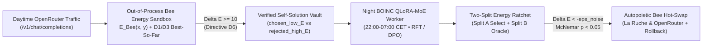

# Operation Autopoietic Energy-Bees (`Season 18` / `Wave 17`)
## Leveraging Measured `AutoevolveAI` (ANSE) Results to Add a Physical Energy Model & Self-Evolving Loop to HiveMind Bees

- **Date:** 2026-10-26
- **Source Repositories:** [`xaviercallens/AutoevolveAI`](https://github.com/xaviercallens/AutoevolveAI) (ANSE Phases 1–5) $\times$ [`xaviercallens/HiveMind`](https://github.com/xaviercallens/HiveMind) (La Ruche, BOINC Core Node & OpenRouter Gateway)
- **Target Roadmap Section:** `ROADMAP.md` Section `3.16` (`Season 18` — `HM-S18-AE-01..05`)

---

## 1. Motivation: Two Measured Bottlenecks in HiveMind Live Operations

Recent real-life production runs on the HiveMind fleet (`socreateai-agora-hermes-node1` Tesla T4 16 GB + GeForce RTX 2070 8 GB) exposed two concrete limitations of purely token-loss-driven training and unverified routing:

1. **The 30-Round BOINC Token-NLL Plateau (`scripts/t4_training_report.py`, 25–26 Oct 2026):**
   - Across `98` chained BOINC QLoRA-MoE rounds (`hmq_00001..hmq_00098`, `5,632.11` Cobblestones), 6-domain held-out cross-entropy NLL improved from `2.2705 -> 2.1380` (`-5.8%`, with `math -15.1%`, `biomed -11.7%`, `general -8.8%`).
   - However, **held-out NLL plateaued after ~30 rounds**: later blocks of 10 rounds improved by only `0.0005–0.005` (`std = 0.0055` over the last 20 rounds), and in rounds `69–98` a round no longer improved even the domain it trained on (`+0.0006`).
   - Furthermore, choosing chain head `hmq_00092` (`20` accepted / `78` held) on the same fixed `8 x 128`-token evaluation sets introduces **best-of-97 selection bias**, and token NLL alone does not measure downstream executable correctness.

2. **Token NLL $\neq$ Physical Execution Correctness (`NIGHT-MOE-1` & `HM-S16-04`):**
   - On Day 1 of Go-Live (`HM-S16-04`), the first real coding query was served with low latency (`198 ms` p50) but returned code that failed execution.
   - In `NIGHT-MOE-1`, fine-tuning small specialist adapters on terse static reference answers caused format interference on `maths` and `code`, whereas `hivemind/bee-stars` succeeded (`0.489 -> 0.893`, `+40.4%`, exact paired McNemar $p < 10^{-4}$) when evaluated against an explicit, discrete verification gate with a shuffled-label control.

---

## 2. Evidence Audit from `AutoevolveAI` (What Worked vs. What Was Refuted)

To avoid importing complexity that does not work, we filter [`AutoevolveAI`](https://github.com/xaviercallens/AutoevolveAI)'s experimental record (`docs/EVOLUTION_LAB.md`, `results/phase{1,2,3}_evolution/results.json`, `results/semantic_backprop_and_the_wall.json`, `results/rung2_gate_cost.json`) into **proven mechanisms to adopt** and **refuted mechanisms to exclude**:

### 2.1 Proven Mechanisms to Adopt in HiveMind Bees
| `AutoevolveAI` Component | Measured Evidence in `AutoevolveAI` | Application to HiveMind Specialist Bees |
|---|---|---|
| **1. Phase 1 Reality Engine & Graded Physical Energy $E(y)$** (`anse/symbolic/sandbox.py`) | Exposed **36% false convergence** (`4/11` self-graded successes failed hidden tests). Plain retry with hidden-test graded energy lifted verified `pass@1 = 42.5% -> pass@3 = 52.5%` on `qwen2.5-coder:1.5b`; `0` crashes or memory poisonings across `8` hostile scenarios (`UC5 PASS`). | Replace self-graded / token-NLL checks with an out-of-process **Bee Physical Energy Function $E_{\text{Bee}}(x, y)$** combining hidden test failure rate, execution latency (ms), peak RSS memory (MB), and domain conservation laws ($E = 10^6$ on crash/timeout/stub). |
| **2. Phase 3 Autopoietic Hot-Swapping & Banach Registry** (`anse/autopoiesis/hypervisor.py`) | **5/5 Gates Passed:** Promoted better children (`5/5`, median `75x` speedup), rejected fast-but-wrong children (`5/5` vs `0/5` legacy), `0/15` false promotions on A/A noise (vs `5/15` legacy), `5/5` instant rollbacks, and `2/2` valid LLM-proposed children promoted (`0` invalid). | Gate every La Ruche / OpenRouter Bee adapter promotion (`theta_parent -> theta_child`) on an out-of-process equivalence check + interleaved noise-margin thermodynamic condition $\Delta E = E_{\text{child}} - E_{\text{parent}} < -\epsilon_{\text{noise}}$. |
| **3. Phase 4 Low-Tier Hardness Directives `D1, D3, D6`** (`docs/EVOLUTION_LAB.md`) | Designed for $\le 3\text{B}$–$7\text{B}$ models: `D1` compresses failing code/stderr to `<200` chars; `D3` enforces energy-monotonic early stop ($E_2 > E_1$) and returns **best-so-far** ($\arg\min_t E_t$); `D6` exports verified preference pairs when $\Delta E \ge 10$. | Prevent token waste on 1B–7B Bees (`coder-lite`, `crowd-v1`, `bee-stars`, `coder`), guarantee non-increasing energy across retries, and harvest live `(chosen_low_E, rejected_high_E)` pairs for Night-MoE QLoRA self-evolution. |
| **4. Rung-2 Formal Gate & Warm Verifier Amortization** (`results/rung2_gate_cost.json`, `rung2_gate_controls.json`) | Proved `4/4` positive/negative obligation controls (`0` `sorry` or wrong-coefficient leaks) and showed that **Mathlib import (`17.61 s` median)** is ~100% of single-shot Lean verification cost (`spec + candidate` add `~0 s`). | Run a **persistent warm verifier daemon** (Lean 4 REPL / persistent Python worker pool) on the T4 / BOINC validator node so candidate Bee outputs are checked in milliseconds without paying the per-process import floor. |
| **5. System-1 Fast Soundness Pre-Ranker** (`results/retrained_models_use_cases_report.json`) | `laya_system_one` achieved `10/10` (`100%`) accuracy distinguishing sound vs. unsound physics/math/Lean4/ML candidates in `~1.08 s`; MCTS candidate ordering achieved `24.6x–155.4x` speedup over blind sandbox evaluation. | Use a lightweight System-1 probe strictly to **order** candidate Bee responses or route `hivemind/auto` before executing the winning candidate in the real sandbox. |

### 2.2 Refuted Mechanisms Explicitly Excluded
1. **No Unverified JEPA Latent Skipping (`Phase 2 UC1/UC4 FAIL`):** In `AutoevolveAI` Phase 2, the standalone JEPA energy predictor scored `40.0%` vs `44.3%` random on candidate selection (`UC4 FAIL`). **Rule:** Latent predictors may only *order* candidates; **every** promoted Bee or verified response must pass the real sandbox (`E_Bee`).
2. **No Full-Solution Lesson Injection or Multi-Turn Adaptive Retry on $\le 3\text{B}$ Bees (`Phase 1 UC2/UC4 FAIL`):** Injecting full reference solutions into small models caused `3` regressions vs `1` gain (`50%` off vs `40%` on), and verbose adaptive retries raised mean energy (`22.5 -> 24.0 -> 29.0`). **Rule:** Use plain retry with `<200`-char compressed error traces (`D1`) and keep the best-so-far candidate (`D3`).
3. **No Complex Genetic Crossover Operators Without Curriculum Split (`semantic_backprop_and_the_wall.json`):** Eight tested GP/semantic variation operators all collapsed at the exact same complexity cliff (`L3 -> L4`), proving the bottleneck is **task decomposition and representation**, not the mutation operator.

---

## 3. Mathematical Formulation of the HiveMind Bee Energy Model

For any prompt $x$ in domain $d \in \{\text{code}, \text{math/lean4}, \text{astro/physics}, \text{biomed}, \text{general}\}$ and candidate response $y \sim \pi_{\theta_d}(\cdot \mid x)$ from Specialist Bee $\theta_d$, the **Physical Energy Function** $E_{\text{Bee}}(x, y; d)$ is evaluated out-of-process:

$$E_{\text{Bee}}(x, y; d) = \begin{cases} 10^6 & \text{if syntax error, AST stub, timeout, crash, or } \texttt{sorry} \\ w_{\text{fail}} \cdot \frac{N_{\text{fail}}(x, y)}{N_{\text{tests}}(x)} + w_{\text{inv}} \cdot \mathcal{R}_{\text{phys}}(x, y) + w_{\text{lat}} \cdot \frac{\tau_{\text{ms}}(y)}{\tau_0} + w_{\text{mem}} \cdot \frac{M_{\text{peak}}(y)}{M_0} & \text{otherwise} \end{cases}$$

where:
- $N_{\text{fail}}(x, y) / N_{\text{tests}}(x) \in [0, 1]$ is the fraction of hidden unit tests or exact paired evaluation items failed ($w_{\text{fail}} = 100.0$),
- $\mathcal{R}_{\text{phys}}(x, y) \ge 0$ is the domain conservation/epistemic residual (e.g., $|\Delta H / H_0|$ for symplectic astrophysics, `defeq` obligation mismatch for Lean 4, or format/constraint violation for factual packs; $w_{\text{inv}} = 50.0$),
- $\tau_{\text{ms}}(y)$ and $M_{\text{peak}}(y)$ are measured execution time and peak resident memory inside the `rlimit` sandbox ($w_{\text{lat}} = 1.0, w_{\text{mem}} = 0.5$).

### Thermodynamic Condition for Bee Self-Evolution
A child Bee adapter $\theta_d^{(t+1)}$ trained during the European Night BOINC window (`22:00–07:00 CET`) replaces the parent Bee $\theta_d^{(t)}$ in La Ruche and on the OpenRouter gateway **if and only if** three joint conditions hold on an **independent held-out oracle split $\mathcal{D}_{\text{oracle}}$** (never used during inner training or per-round ratchet selection):

$$\Delta E_d = \operatorname{median}_{(x_i) \in \mathcal{D}_{\text{oracle}}} \Big( E_{\text{Bee}}(x_i, \theta_d^{(t+1)}) - E_{\text{Bee}}(x_i, \theta_d^{(t)}) \Big) < -\epsilon_{\text{noise}}, \quad p_{\text{McNemar}}(\theta_d^{(t+1)} > \theta_d^{(t)}) < 0.05, \quad \text{and} \quad \text{Control}_{\text{shuffled}} = \text{NS}.$$

---

## 4. Proposed Roadmap Evolution: Season 18 (`Wave 17` — `HM-S18-AE-01` to `HM-S18-AE-05`)

| Task ID | Branch Prefix | Target Subsystem | Deliverable & `AutoevolveAI` Synergy | Gate |
| :--- | :--- | :--- | :--- | :---: |
| **`HM-S18-AE-01`** | `feat/s18-bee-energy-sandbox` | `src/hivemind/verification/bee_energy.py` & `src/hivemind/router/gateway.py` | **Out-of-Process Bee Physical Energy Evaluator ($E_{\text{Bee}}$) & Directives `D1`/`D3`**: Port `AutoevolveAI` Phase 1's graded hidden-test sandbox (`rlimit` memory/CPU cap, AST anti-stub check, `E = 1e6` fail-closed penalty) + `D1` (`<200`-char stderr compression) + `D3` (best-so-far $\arg\min_t E_t$ and energy-monotonic early stop when $E_2 > E_1$) into HiveMind's verified completion mode (`HM-S16-04`). | **G-AE1:** `0` false convergences on 20 seeded buggy replies; verified `pass@2 > pass@1` on held-out coding pack. |
| **`HM-S18-AE-02`** | `feat/s18-boinc-two-split-energy-ratchet` | `src/hivemind/boinc/` & `scripts/t4_training_report.py` | **Two-Split BOINC Energy Ratchet & Plateau Auto-Curriculum**: Address the 30-round token-NLL plateau (`std = 0.0055` in `hmq_00001..00098`) by splitting held-out evaluation into **Split A** (per-round ratchet selection) and **Split B** (independent held-out physical energy & accuracy oracle evaluated every 10 rounds). Automatically rotate domain shards or Anneal/Reset LoRA LR when 10-round Split-A gain drops below `0.005` nats. | **G-AE2:** Zero best-of-$N$ optimism gap between Split B and newly drawn test items; automatic plateau detection triggers on `hmq_00001..00098` replay at round ~32. |
| **`HM-S18-AE-03`** | `feat/s18-self-evolving-bee-dpo-rft` | `src/hivemind/swarm/self_evolving_bee.py` | **Self-Evolving Bee Loop via Live Energy-Gap RFT/DPO (`Directive D6` + `E15/E17`)**: Whenever a daytime retry or sibling Bee rescues a failed prompt with $\Delta E = E_{\text{rejected}} - E_{\text{chosen}} \ge 10$ and $E_{\text{chosen}} = 0$, record the verified `(prompt, y_chosen, y_rejected)` pair. Train Night-MoE QLoRA adapters on verified self-generated solutions (eliminating the format interference observed with terse external gold text in `NIGHT-MOE-1`). | **G-AE3:** Paired McNemar $p < 0.05$ gain over base on own domain pack (`code` or `maths`), shuffled-label control `NS`, and `0` Bonferroni-significant harms on other packs. |
| **`HM-S18-AE-04`** | `feat/s18-autopoietic-bee-hotswap` | `src/hivemind/swarm/la_ruche_vault.py` | **Autopoietic Bee Hot-Swapping & Banach Fixed-Point Registry (`Phase 3` Port)**: Port `AutoevolveAI` Phase 3's versioned `ComponentRegistry` to La Ruche and OpenRouter. Promote a child Bee adapter only when out-of-process equivalence passes (`0` regressions on parent's verified suite) AND interleaved A/B energy trials satisfy $\operatorname{median}(\Delta E) < -\epsilon_{\text{noise}}$ (`0/15` false promotions on A/A noise), with instant SHA-256 rollback. | **G-AE4:** `5/5` fast-but-wrong child adapters rejected; `0/15` A/A noise promotions; `<1s` rollback to parent adapter verified in pytest. |
| **`HM-S18-AE-05`** | `feat/s18-warm-verifier-and-energy-bandit` | `src/hivemind/router/` & `src/hivemind/verification/` | **Warm Verifier Daemon (`Rung-2` Amortization) & Energy-Aware Bandit Router (`HM-S15-03`)**: Amortize the `17.6 s` Mathlib/sandbox startup floor (`rung2_gate_cost.json`) via a persistent warm verifier worker pool, and update `hivemind/auto`'s contextual bandit using real measured $E_{\text{Bee}}$ rewards (with `laya_system_one` used strictly for candidate ordering, never skipping verification). | **G-AE5:** Verification latency per candidate reduced by $\ge 5\times$ vs cold subprocess invocation; bandit routing outperforms uniform random routing on executable tasks. |
