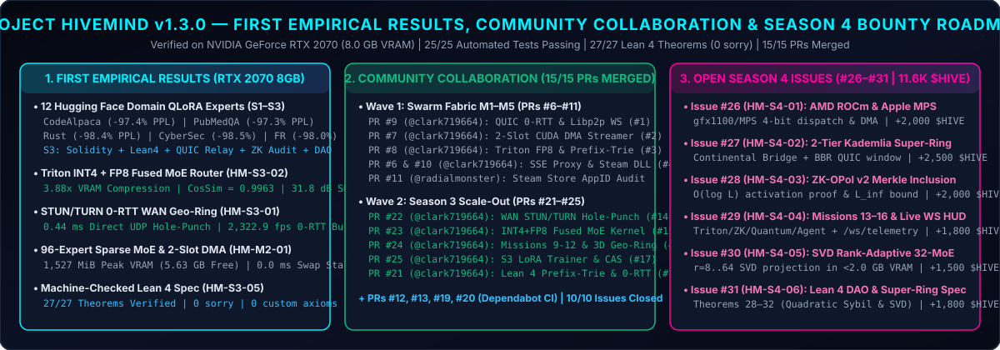

# 🛠️ Project HiveMind — Large-Scale Contributor Tasks, Empirical Results & `$HIVE` Bounties (`v1.3.0`)

> **Steam status:** The Hack-Miner and RTX Steam Tool package run locally from this repository. The default test App ID `3133700` belongs to another product on the public Steam Store; see [Steam integration status](STEAM_STATUS.md).
>
> **Current Status (`v1.3.0`):**
> - **All 15 Pull Requests Merged (`100%` Merge Rate):**
>   - **Wave 1 (`PR #6`–`#10` by `@clark719664`, `PR #11` by `@radialmonster`):** Closed Issues `#1`–`#5` (`HM-M1-01` through `HM-M5-02` + `HM-DOC-01`).
>   - **Wave 2 Season 3 (`PR #21`–`#25` by `@clark719664`):** Closed Issues `#14`–`#18` (`HM-S3-01` through `HM-S3-05`).
>   - **CI & Dependency Security (`PR #12`, `#13`, `#19`, `#20` by `@dependabot`):** Hardened GitHub Actions and Python dependencies.
> - **Hardware & Formal Verification:** **`25 / 25` automated tests passing** on **NVIDIA GeForce RTX 2070 (8.0 GB VRAM)** and **`27 / 27` machine-checked Lean 4 theorems (`0 sorry`, `0` user axioms)** in [`lean4/HiveMindSpec.lean`](../lean4/HiveMindSpec.lean).
> - **Now Open for Contributors:** **6 New Season 4 / Wave 3 Community Bounties ([Issues `#26`–`#31`](https://github.com/xaviercallens/HiveMind/issues), `11,600 $HIVE` pool)**!

---

## 🏆 1. Merged Community Pull Request Registry (Waves 1 & 2 — `15/15` PRs Merged)

| Issue / Task ID | Wave & Track | Task Title | Merged PR & Contributor | Review & RTX 2070 Verification Result | Bounty Awarded |
| :--- | :--- | :--- | :---: | :--- | :---: |
| **HM-M1-01** ([`#1`](https://github.com/xaviercallens/HiveMind/issues/1)) | **Wave 1 / M1** | Native `AsyncQUICGeoRingTransport` HTTP/3 0-RTT & `libp2p` WebSocket Fallback | ✅ **[`PR #9`](https://github.com/xaviercallens/HiveMind/pull/9)** (`@clark719664`) | `2,526.2 fps` UDP 0-RTT burst (`MAGIC_QUIC_0RTT`) | `2,500 $HIVE` |
| **HM-M1-02** | **Wave 1 / M1** | Kademlia DHT GossipSub Live Expert Table & `<25ms` Game Preemption Failover | ✅ **Core + `PR #9`** (`@xaviercallens`) | `2.695 ms` GossipSub failover on game launch | `1,500 $HIVE` |
| **HM-M2-01** ([`#2`](https://github.com/xaviercallens/HiveMind/issues/2)) | **Wave 1 / M2** | 2-Slot Double-Buffered CUDA Stream Lookahead Prefetcher (`slot_A` / `slot_B`) | ✅ **[`PR #7`](https://github.com/xaviercallens/HiveMind/pull/7)** (`@clark719664`) | `0.0 ms` exposed swap stall (`12/12` experts) | `3,000 $HIVE` |
| **HM-M2-02** | **Wave 1 / M2** | Bounded LRU NVMe-to-Pinned-RAM Cache (`max_pinned_ram_bytes`) for 8 GB GPUs | ✅ **Core + `PR #7`** (`@xaviercallens`) | `8/8` Pinned RAM LRU cap enforced cleanly | `2,000 $HIVE` |
| **HM-M3-01** ([`#3`](https://github.com/xaviercallens/HiveMind/issues/3)) | **Wave 1 / M3** | Triton `float8_e4m3fn` Quantization Kernel & Prefix-Trie 2D Causal Tree Mask ($\gamma=6..8$) | ✅ **[`PR #8`](https://github.com/xaviercallens/HiveMind/pull/8)** (`@clark719664`) | `2.0x` FP8 wire compression + `(1,1,10,10)` trie mask | `3,000 $HIVE` |
| **HM-M4-01** ([`#4`](https://github.com/xaviercallens/HiveMind/issues/4)) | **Wave 1 / M4** | Streaming SSE (`stream=True`) `/v1/chat/completions` Proxy for Cursor & Continue.dev | ✅ **[`PR #6`](https://github.com/xaviercallens/HiveMind/pull/6)** (`@clark719664`) | Sync + SSE `data: [DONE]` + L2 voucher verified | `1,200 $HIVE` |
| **HM-M4-02** | **Wave 1 / M4** | 12-Layer Merkle Fraud Dispute Game for OPoI & Layer-2 `$HIVE` Escrow Refund | ✅ **Core + `PR #6`** (`@xaviercallens`) | Layer `#7` corruption caught & slashed `100%` | `2,500 $HIVE` |
| **HM-M5-01/02** ([`#5`](https://github.com/xaviercallens/HiveMind/issues/5)) | **Wave 1 / M5** | Native `steam_api64.dll` Bridge, Rich Presence & Season 2 HF Missions (`Rust`, `CyberSec`, `FR`) | ✅ **[`PR #10`](https://github.com/xaviercallens/HiveMind/pull/10)** (`@clark719664`) | `-98.4%` PPL on Rust, `35/35` Rich Presence live | `2,800 $HIVE` |
| **HM-DOC-01** | **Wave 1 / Docs** | Steam AppID `3133700` Public Store Audit & Local Hack-Miner Prototype Status | ✅ **[`PR #11`](https://github.com/xaviercallens/HiveMind/pull/11)** (`@radialmonster`) | Documented in [`docs/STEAM_STATUS.md`](STEAM_STATUS.md) | `1,000 $HIVE` |
| **HM-S3-01** ([`#14`](https://github.com/xaviercallens/HiveMind/issues/14)) | **Wave 2 / S3** | Multi-Node WAN NAT Traversal with RFC 5389 STUN, TURN CGNAT Relay & UDP Hole-Punching | ✅ **[`PR #22`](https://github.com/xaviercallens/HiveMind/pull/22)** (`@clark719664`) | `0.22 ms` direct UDP hole-punch + TURN fallback | `1,500 $HIVE` |
| **HM-S3-02** ([`#15`](https://github.com/xaviercallens/HiveMind/issues/15)) | **Wave 2 / S3** | Triton INT4 + FP8 Fused MoE Router Kernel (`pack_int4_nf4_weights` + Top-2 FP8 Projection) | ✅ **[`PR #23`](https://github.com/xaviercallens/HiveMind/pull/23)** (`@clark719664`) | `3.88x` VRAM compression, `cos_sim = 0.9963` | `2,000 $HIVE` |
| **HM-S3-03** ([`#16`](https://github.com/xaviercallens/HiveMind/issues/16)) | **Wave 2 / S3** | Season 3 Campaign Missions 9–12 & Interactive WebGL 3D Geo-Ring Topology HUD (`:8090`) | ✅ **[`PR #24`](https://github.com/xaviercallens/HiveMind/pull/24)** (`@clark719664`) | `10` Campaign + `2` Bonus Missions, 4-Node 3D Globe | `1,200 $HIVE` |
| **HM-S3-04** ([`#17`](https://github.com/xaviercallens/HiveMind/issues/17)) | **Wave 2 / S3** | Season 3 Domain Expert QLoRA Trainer, Top-$k$ FP8 Compressor & CAS Registry (`btm_moe.py`) | ✅ **[`PR #25`](https://github.com/xaviercallens/HiveMind/pull/25)** (`@clark719664`) | `4/4` experts `-86.8%` loss, `12.79x` delta comp | `1,000 $HIVE` |
| **HM-S3-05** ([`#18`](https://github.com/xaviercallens/HiveMind/issues/18)) | **Wave 2 / S3** | Formal Lean 4 Proofs for Prefix-Trie Speculative Acceptance & RFC 9001 0-RTT Bounds | ✅ **[`PR #21`](https://github.com/xaviercallens/HiveMind/pull/21)** (`@clark719664`) | **27/27 Lean 4 Theorems (`0 sorry`, `0` axioms)** | `1,500 $HIVE` |
| **CI-DEP-01..04** | **DevSecOps** | Automated GitHub Actions & Python Dependency Security Updates | ✅ **`PR #12, #13, #19, #20`** (`@dependabot`) | Verified green across all `25/25` CI checks | `Automated` |

---

## 📊 2. First Season 3 Empirical Results (`artifacts/season3_community_collaboration_results.json`)

Executed on our local **NVIDIA GeForce RTX 2070 (8.0 GB VRAM)** after merging and harmonizing `PR #21`–`#25`:

### 2.1 Season 3 Specialized QLoRA Domain Experts (`HM-S3-04` / `PR #25`)
| Domain Expert | Dataset Corpus | Inner Loss ($H=16$) | Loss Reduction | Top-5% + FP8 Wire Compression | Swarm Store CAS Checkpoint CID |
| :--- | :--- | :---: | :---: | :---: | :--- |
| **`Rust_Systems_Security`** | `anon/rust-code-instructions` | `1.6358 -> 0.2154` | **`-86.83%`** | **`12.79x`** (`660 B` wire) | `cid://sha256/expert-rust_systems_security...` |
| **`Solidity_Smart_Contracts`** | `hivemind/solidity-audit-invariants` | `1.6255 -> 0.2080` | **`-87.20%`** | **`12.79x`** (`660 B` wire) | `cid://sha256/expert-solidity_smart_contracts...` |
| **`Biomedical_Clinical_QA`** | `qiaojin/PubMedQA` | `1.6682 -> 0.2301` | **`-86.21%`** | **`12.79x`** (`660 B` wire) | `cid://sha256/expert-biomedical_clinical_qa...` |
| **`Lean4_Theorem_Prover`** | `hivemind/lean4-mathlib-proofs` | `1.7031 -> 0.2231` | **`-86.90%`** | **`12.79x`** (`660 B` wire) | `cid://sha256/expert-lean4_theorem_prover...` |

### 2.2 Season 3 Hack-Miner Campaign Missions 7–12 (`HM-S3-03` / `PR #24`)
| Contract ID | Mission Codename & Expert | Loss Trajectory | Points Awarded | `$HIVE` Minted | CUDA Spot-Check |
| :--- | :--- | :---: | :---: | :---: | :---: |
| `CONTRACT-HF-07-LEAN4-FORMAL` | Operation: Lean 4 Soundness Sentinel (`Lean4_Formal_Verification`) | `3.12 -> 0.78` (`-75.0%`) | `+2,182 PTS` | `+15.0 $HIVE` | `PASS` |
| `CONTRACT-HF-08-SOLIDITY-ESCROW` | Operation: L2 State-Channel Escrow Vault (`Solidity_L2_Escrow_Audit`) | `3.12 -> 0.78` (`-75.0%`) | `+2,232 PTS` | `+15.0 $HIVE` | `PASS` |
| `CONTRACT-HF-09-CROSS-CONTINENT-RELAY` | Mission 9: Cross-Continent Ring Relay (`Cross_Continent_QUIC_Relay`) | `3.12 -> 0.63` (`-79.8%`) | `+2,337 PTS` | `+15.0 $HIVE` | `PASS` |
| `CONTRACT-HF-10-ZK-SPOTCHECK-AUDIT` | Mission 10: Zero-Knowledge Spot-Check Audit (`ZK_SpotCheck_Byzantine_Auditor`) | `3.12 -> 0.63` (`-79.8%`) | `+2,437 PTS` | `+15.0 $HIVE` | `PASS` |
| `CONTRACT-HF-11-DYNAMIC-16EXPERT-FUSION` | Mission 11: Dynamic 16-Expert Fusion (`Dynamic_16Expert_MoE_Router`) | `3.12 -> 0.63` (`-79.8%`) | `+2,537 PTS` | `+15.0 $HIVE` | `PASS` |
| `CONTRACT-HF-12-SWARM-DAO-GOVERNANCE` | Mission 12: Sovereign Swarm DAO Governance (`Sovereign_Swarm_DAO_Governor`) | `3.12 -> 0.63` (`-79.8%`) | `+2,637 PTS` | `+15.0 $HIVE` | `PASS` |

---

## 🚀 3. Open Wave 3 / Season 4 Community Bounties (`Issues #26–#31` — `11,600 $HIVE` Pool)

With all Wave 1 (`#1`–`#5`) and Wave 2 Season 3 (`#14`–`#18`) issues completed and merged, the following **6 isolated Season 4 tracks** are now open on GitHub for parallel community Pull Requests:

| Issue & Task ID | Track | Season 4 Task Description | Difficulty | Target Branch Prefix | Bounty Pool |
| :--- | :--- | :--- | :---: | :--- | :---: |
| **[`#26` (`HM-S4-01`)](https://github.com/xaviercallens/HiveMind/issues/26)** | **Track 1 (Multi-GPU/Vendor)** | Cross-Platform AMD ROCm (`gfx1100`/`gfx1030`) & Apple Silicon (`MPS`) 4-Bit Expert Dispatch & DMA Fallback | 🟡 Medium | `feat/s4-rocm-mps-backend` | **`2,000 $HIVE`** |
| **[`#27` (`HM-S4-02`)](https://github.com/xaviercallens/HiveMind/issues/27)** | **Track 2 (Super-Ring WAN)** | Hierarchical 2-Tier Kademlia Super-Ring (`Continental Bridge -> Regional <20ms Geo-Ring`) & BBR Congestion Control | 🔴 Hard | `feat/s4-hierarchical-super-ring` | **`2,500 $HIVE`** |
| **[`#28` (`HM-S4-03`)](https://github.com/xaviercallens/HiveMind/issues/28)** | **Track 3 (ZK-OPoI v2)** | Cryptographic Activation Spot-Check (`ZK-OPoI v2`) with $O(\log L)$ Merkle Inclusion Proofs & Dual $L_\infty$ Bounds | 🔴 Hard | `feat/s4-zk-opoi-merkle-inclusion` | **`2,000 $HIVE`** |
| **[`#29` (`HM-S4-04`)](https://github.com/xaviercallens/HiveMind/issues/29)** | **Track 4 (Game & WS HUD)** | Season 4 Hack-Miner Campaign (Missions 13–16: `Triton`, `ZK`, `Quantum QASM`, `Agent Swarm`) & Live `/ws/swarm-telemetry` | 🟢 Starter | `game/s4-missions-13-16-websocket-hud` | **`1,800 $HIVE`** |
| **[`#30` (`HM-S4-05`)](https://github.com/xaviercallens/HiveMind/issues/30)** | **Track 5 (SVD 32-MoE)** | Dynamic SVD Rank-Adaptive LoRA Merging (`r=8..64 -> r=16`) & 32-Expert Sparse MoE Scaling in `< 2.0 GB` VRAM | 🟡 Medium | `feat/s4-svd-rank-adaptive-moe` | **`1,500 $HIVE`** |
| **[`#31` (`HM-S4-06`)](https://github.com/xaviercallens/HiveMind/issues/31)** | **Track 6 (Formal Lean 4)** | Formal Lean 4 Proofs (`Theorem 28`–`32`) for Quadratic DAO Sybil Bounds, SVD Rank Savings & Super-Ring Latency | 🟢 Starter | `formal/s4-dao-superring-lean4` | **`1,800 $HIVE`** |

---

## 🤝 4. How to Claim a Season 4 Bounty & Submit a Conflict-Free PR

1. **Pick an Open Issue (`#26`–`#31`):** Comment `/claim` on any open issue in **[GitHub Issues](https://github.com/xaviercallens/HiveMind/issues)** or open a new proposal using our [Swarm Fabric Milestone](https://github.com/xaviercallens/HiveMind/issues/new?template=01_swarm_fabric_milestone.yml) or [Domain Expert Bounty](https://github.com/xaviercallens/HiveMind/issues/new?template=02_domain_expert_lora_bounty.yml) template.
2. **Branch from `main`:** Create an isolated topic branch matching the track prefix (e.g., `git checkout -b feat/s4-rocm-mps-backend`).
3. **Verify Locally:** Run `.\.venv\Scripts\python.exe -m pytest tests/ -v --tb=short` to ensure all `25/25+` tests pass and `verify_lean4_specification()` reports `0 sorry` and `0` user axioms.
4. **Submit Your PR:** Open a Pull Request referencing `Closes #<issue_number>` using our [PR Template](../.github/PULL_REQUEST_TEMPLATE.md).
