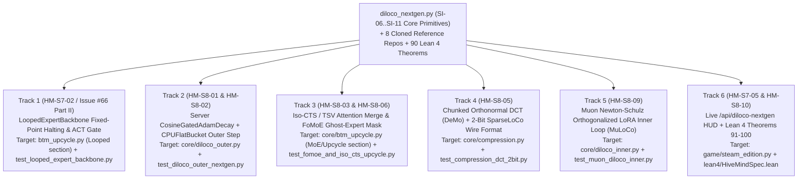

# 🐝 Project HiveMind — Developer Swarm Progression & Parallel Track Blueprint (`Season 7 & Season 8`)

> [!IMPORTANT]
> **⚖️ Binding Non-Monetary Compute-Reciprocity Charter (`0.00 EUR / 0.00 USD`):**
> **Project HiveMind is a strictly voluntary, non-commercial open-source scientific research initiative.**
> - **No financial payment, fiat currency (`0.00 EUR / 0.00 USD`), cryptocurrency, token sale, or monetary remuneration is ever promised, offered, or paid.**
> - All symbolic points (`PTS`) and `$HIVE` Proof-of-Useful-Work (PoUW) accounting units are **non-monetary compute-reciprocity credits**.
> - They confer **exclusively reciprocal computing processing benefits** — priority access to shared Sparse MoE inference and distributed fine-tuning quota — **when the live production HiveMind Swarm is deployed, available, and used by a large community.**

---

## 📊 1. Current Swarm State & Recent Milestones (`v1.9.1`)

- **Total Verified Merged PRs**: **`53 / 53` (`100%` merge rate, `0` open PR backlog)**
  - Recent autonomous & human-agent merges:
    - `PR #92` (`@clark719664`): `feat(moe): looped Prelude -> RecurrentCore x T -> Coda backbone (HM-S7-01)` ([`src/hivemind/core/btm_upcycle.py`](../src/hivemind/core/btm_upcycle.py), `17 passed`)
    - `PR #91` (`@clark719664`): `feat(hud): live worker EF21 residual telemetry on /api/strategy (HM-S7-05)`
    - `PR #90` (`@clark719664`): `feat(opoi): auto-indemnify poisoned rounds from slashing pool (HM-S7-06)`
    - `PR #89` (`@clark719664`): `fix(strategy): reject non-finite / negative RTT and clamp EF21 decay`
    - `PR #88` (`@clark719664`): `fix(ci): make main green again`
- **Formal Verification Gate**: **`90` Machine-Checked Lean 4 Theorems (`0 sorry`, `0` user axioms, `0` compiler warnings)** in [`lean4/HiveMindSpec.lean`](../lean4/HiveMindSpec.lean) (`Seasons 1–10`).
- **Integrated Next-Gen Outer-Loop `DiLoCo` Core (`SI-06`..`SI-11`)**:
  - Core primitives are live in [`src/hivemind/swarm/diloco_nextgen.py`](../src/hivemind/swarm/diloco_nextgen.py) (`10 passed` in [`tests/test_diloco_nextgen.py`](../tests/test_diloco_nextgen.py)), backed by **8 cloned reference repositories** in `sub_projects/hivemind/reference_repos/` and formal citations in [`CITATION.cff`](../CITATION.cff) & [`docs/ACKNOWLEDGMENTS_AND_CITATIONS.md`](ACKNOWLEDGMENTS_AND_CITATIONS.md).

---

## 🧭 2. Conflict-Free Parallel Progression Tracks (`Tracks 1–6`)

To enable multiple human developers and autonomous AI coding agents (`@clark719664`, `@pedromineo`, `@radialmonster`, and new contributors) to submit parallel Pull Requests **without merge conflicts**, the remaining **Season 7 (`Wave 6`)** and **Season 8 (`Wave 7 — "Operation Iso-Sparse-FoMoE"`)** objectives are partitioned into **6 isolated tracks** with disjoint primary file targets:



| Track | Task IDs | Primary Target Files (Conflict-Free Partition) | Verification Command | Symbolic Compute Credits (`0.00 EUR/USD`) |
| :--- | :--- | :--- | :--- | :--- |
| **Track 1** | `HM-S7-02` (`#66` Pt II) | `src/hivemind/core/btm_upcycle.py` (`LoopedExpertBackbone`), `tests/test_looped_expert_backbone.py` | `pytest tests/test_looped_expert_backbone.py` | `+3,500 $HIVE` |
| **Track 2** | `HM-S8-01`, `HM-S8-02` | `src/hivemind/core/diloco_outer.py`, `tests/test_diloco_outer_nextgen.py` | `pytest tests/test_diloco_outer_nextgen.py` | `+4,000 $HIVE` |
| **Track 3** | `HM-S8-03`, `HM-S8-06` | `src/hivemind/core/btm_upcycle.py` (`SparseMoEMLPBlock` & `upcycle_branches_to_sparse_moe`), `tests/test_fomoe_and_iso_cts_upcycle.py` | `pytest tests/test_fomoe_and_iso_cts_upcycle.py` | `+4,500 $HIVE` |
| **Track 4** | `HM-S8-05` | `src/hivemind/core/compression.py`, `tests/test_compression_dct_2bit.py` | `pytest tests/test_compression_dct_2bit.py` | `+3,500 $HIVE` |
| **Track 5** | `HM-S8-09` | `src/hivemind/core/diloco_inner.py`, `src/hivemind/client/worker_node.py`, `tests/test_muon_diloco_inner.py` | `pytest tests/test_muon_diloco_inner.py` | `+3,500 $HIVE` |
| **Track 6** | `HM-S7-05`, `HM-S8-10` | `src/hivemind/game/steam_edition.py`, `lean4/HiveMindSpec.lean`, `tests/test_steam_edition.py` | `pytest tests/test_steam_edition.py && cd lean4 && lake build` | `+4,000 $HIVE` |

---

## 🛠️ 3. Detailed Engineering Specifications per Track

### 🔹 Track 1 (`HM-S7-02` & Issue `#66` Part II): Fixed-Point Stability Detector, ACT Ponder Gate & Truncated Fixed-Point Backprop
- **Literature & Reference**:
  - Huang et al. (2026), *Towards Looped Models Done Right, Part I (`arXiv:2610.23036`) & Part II: Rethinking at Fixed Points (`arXiv:2610.06833`)* (`https://github.com/ifm-ai/xllm-loop`).
- **What Already Exists**:
  - `@clark719664` implemented `LoopedExpertBackbone` (`Prelude -> RecurrentCore x T -> Coda`) and `LoopedBackboneReport` in [`src/hivemind/core/btm_upcycle.py`](../src/hivemind/core/btm_upcycle.py) (`PR #92`).
- **What to Implement Next**:
  1. **Per-Token Fixed-Point Convergence / Early-Exit Gate (`fixed_point_tol: float | None = None`)**:
     - At each recurrent core iteration $t \in \{1..T\}$, compute the per-token relative state drift:
       $$\delta_t(b, s) = \frac{\|h^{(t)}_{b,s} - h^{(t-1)}_{b,s}\|_2}{\max(\|h^{(t-1)}_{b,s}\|_2, 10^{-6})}$$
     - When `fixed_point_tol` is set and $\delta_t(b, s) \le \text{fixed\_point\_tol}$, freeze/preserve $h^{(t)}_{b,s}$ for remaining loop steps (or weight via an ACT halting gate $p_t = \sigma(w_p^\top h^{(t)} + b_p)$ with ponder penalty $\tau \sum_t N_t$).
  2. **Truncated Backprop at Fixed Points (`truncated_bptt_steps: int | None = None`)**:
     - When `truncated_bptt_steps = k` ($1 \le k < T$), run the first $T - k$ loop steps under `torch.no_grad()` (or detach `hidden_states` before step $T - k$) so gradients flow only through the final $k$ fixed-point refinement steps plus `injected`, cutting activation memory inside the 8 GB VRAM ceiling.
  3. **Telemetry**:
     - Record `last_mean_effective_steps: float`, `last_early_exit_fraction: float`, and `last_fixed_point_residual: float` on `LoopedExpertBackbone` and `LoopedBackboneReport`.

---

### 🔹 Track 2 (`HM-S8-01` & `HM-S8-02`): Server-Side `CosineGatedAdamDecay` Outer Optimizer & Zero-VRAM `CPUOffloadedFlatBucket`
- **Literature & Reference**:
  - *Communication-Efficient Distributed LLM Pre-Training via Optimized Outer Loop (`AdamDecay`)* (`arXiv:2605.09126`)
  - Jaghouar et al. (`PrimeIntellect-ai/prime-diloco` & `OpenDiLoCo`, `arXiv:2407.07852`, cloned in `sub_projects/hivemind/reference_repos/prime-diloco`)
- **What Already Exists**:
  - [`CosineGatedAdamDecayOuterOptimizer`](../src/hivemind/swarm/diloco_nextgen.py) and [`CPUOffloadedFlatBucketOuterState`](../src/hivemind/swarm/diloco_nextgen.py) are implemented and tested in `src/hivemind/swarm/diloco_nextgen.py`.
  - [`DiLoCoOuterOptimizer`](../src/hivemind/core/diloco_outer.py) currently runs Multi-Krum (`filter_byzantine_deltas_multikrum`) + `fl_guard.clip_and_aggregate_surviving_deltas` followed by Nesterov momentum.
- **What to Implement Next**:
  1. Add `outer_optimizer_mode: str = "nesterov"` (`"nesterov"` | `"cosine_gated_adam_decay"`) and `use_cpu_flat_bucket: bool = False` to `DiLoCoOuterOptimizer.__init__` in [`src/hivemind/core/diloco_outer.py`](../src/hivemind/core/diloco_outer.py).
  2. In `DiLoCoOuterOptimizer.step(...)`, when `outer_optimizer_mode == "cosine_gated_adam_decay"`, apply `CosineGatedAdamDecayOuterOptimizer.step(branch_name, theta_prev, aggregated_deltas)` (or `CPUOffloadedFlatBucketOuterState.outer_nesterov_step` when `use_cpu_flat_bucket=True`).
  3. Add optional telemetry fields (`outer_optimizer_mode: str = "nesterov"`, `mean_cosine_gate: float | None = None`, `extra_gpu_vram_bytes: int = 0`) to `OuterStepResult`.
  4. Add unit tests in `tests/test_diloco_outer_nextgen.py` verifying Byzantine Multi-Krum filtering + `CosineGatedAdamDecay` + `CPUOffloadedFlatBucketOuterState` end-to-end.

---

### 🔹 Track 3 (`HM-S8-03` & `HM-S8-06`): `Iso-CTS` / `TSV` Subspace Attention Merging & `FoMoE` Ghost-Expert `Skip-Token` Routing
- **Literature & Reference**:
  - Shoouri et al. (`shoroi/isoloco`, `arXiv:2607.03011`, cloned in `sub_projects/hivemind/reference_repos/isoloco`) & Gargiulo et al. (`TSV`, `arXiv:2412.00081`)
  - *FoMoE: Federated Mixture-of-Experts with Ephemeral Replication* (`arXiv:2606.19025`)
- **What Already Exists**:
  - [`ReputationWeightedIsoCTSMerger`](../src/hivemind/swarm/diloco_nextgen.py), [`TSVDecorrelatedMerger`](../src/hivemind/swarm/diloco_nextgen.py), and [`FoMoEPartialReplicaPlanner`](../src/hivemind/swarm/diloco_nextgen.py) in `src/hivemind/swarm/diloco_nextgen.py`.
- **What to Implement Next**:
  1. In [`upcycle_branches_to_sparse_moe`](../src/hivemind/core/btm_upcycle.py) (`L1112–1213`), add `attention_merge_mode: str = "uniform"` (`"uniform"` | `"iso_cts"` | `"tsv"`) and `branch_reputations: dict[str, float] | None = None`:
     - When `attention_merge_mode == "iso_cts"`, merge the per-branch self-attention deltas $\Delta W_e = \frac{\alpha}{r} B_e A_e$ using `ReputationWeightedIsoCTSMerger().merge(...)`.
     - When `attention_merge_mode == "tsv"`, merge via `TSVDecorrelatedMerger().merge(...)`.
  2. In [`SparseMoEMLPBlock`](../src/hivemind/core/btm_upcycle.py) (`L521–591`) and [`UpcycledSparseMoEModel`](../src/hivemind/core/btm_upcycle.py), add `set_local_expert_subset(local_expert_indices: Sequence[int] | None)`:
     - When a subset $E_k \subset \{0..E-1\}$ is active (`FoMoE` partial replication), tokens routed to a non-resident Ghost Expert ($i \notin E_k$) skip remote FFN evaluation (`Skip-Token` rule, `0` inner-step network stalls) and track `ghost_skipped_assignments: int` in block telemetry.
  3. Add unit tests in `tests/test_fomoe_and_iso_cts_upcycle.py`.

---

### 🔹 Track 4 (`HM-S8-05`): Chunked Orthonormal DCT (`DeMo`) & 2-Bit `SparseLoCo` Wire Compression
- **Literature & Reference**:
  - Peng et al. (`bloc97/DeMo`, `arXiv:2411.19870`, cloned in `sub_projects/hivemind/reference_repos/DeMo`)
  - Sarfi et al. (`one-covenant/SparseLoCo`, `arXiv:2508.15706`, cloned in `sub_projects/hivemind/reference_repos/SparseLoCo`) & *PULSELoCo* (`arXiv:2602.03839`)
- **What Already Exists**:
  - [`ChunkedOrthonormalDCTTransform`](../src/hivemind/swarm/diloco_nextgen.py) and [`ComputeVisibleSparseLoCoCompressor`](../src/hivemind/swarm/diloco_nextgen.py) in `src/hivemind/swarm/diloco_nextgen.py`.
- **What to Implement Next**:
  1. In [`src/hivemind/core/compression.py`](../src/hivemind/core/compression.py), add `compress_lora_delta_dct_sparse_2bit(...)` and `decompress_lora_delta_dct_sparse_2bit(...)` (plus optional `compression_mode: str = "topk_fp8"` in `compress_lora_delta` / `decompress_lora_delta`).
  2. Pack 2-bit LUT indices (4 values per `uint8` byte, `0.25 B/val`) and compute accurate wire byte counts so `CompressedDeltaPackage.compression_ratio` achieves `>= 16.0x` wire reduction with bounded reconstruction error.
  3. Add unit tests in `tests/test_compression_dct_2bit.py`.

---

### 🔹 Track 5 (`HM-S8-09`): Inner-Loop `Muon` Newton-Schulz Orthogonalized LoRA Preconditioner (`MuLoCo`)
- **Literature & Reference**:
  - Morales (2026) (`arXiv:2610.19064`) & Therien et al. (`MuLoCo`, `arXiv:2607.12925`)
- **What Already Exists**:
  - [`MuonNewtonSchulzLoRAPreconditioner`](../src/hivemind/swarm/diloco_nextgen.py) in `src/hivemind/swarm/diloco_nextgen.py`.
- **What to Implement Next**:
  1. In [`run_diloco_inner_loop`](../src/hivemind/core/diloco_inner.py) and [`HiveMindWorkerNode.execute_workunit`](../src/hivemind/client/worker_node.py), add `use_muon_lora_preconditioner: bool = False` and `muon_ns_steps: int = 5`.
  2. Inside the inner step loop, after `loss.backward()` and gradient norm clipping, when `use_muon_lora_preconditioner=True`, orthogonalize 2D `lora_` parameter gradients in-place using `MuonNewtonSchulzLoRAPreconditioner(ns_steps=muon_ns_steps).precondition_gradient(p.grad)`.
  3. Record `muon_preconditioned_steps: int = 0` on `InnerLoopResult` and test in `tests/test_muon_diloco_inner.py`.

---

### 🔹 Track 6 (`HM-S7-05` & `HM-S8-10`): Live `/api/diloco-nextgen` Command HUD & Formal Lean 4 Proofs (`Theorems 91–100`)
- **Primary Files**: [`src/hivemind/game/steam_edition.py`](../src/hivemind/game/steam_edition.py), [`lean4/HiveMindSpec.lean`](../lean4/HiveMindSpec.lean), [`tests/test_steam_edition.py`](../tests/test_steam_edition.py)
- **What to Implement Next**:
  1. Add a `GET /api/diloco-nextgen` JSON endpoint to the Steam Command Center HTTP server in [`src/hivemind/game/steam_edition.py`](../src/hivemind/game/steam_edition.py) returning live Season 8 telemetry (`AutoLoCo` variance ratio $\rho_t$, `HeLoCo` drift norms, `Skip-Attention` CAR hit-rate, `FoMoE` active vs. ghost expert counts, and `LEVERAGED_GITHUB_REPOSITORIES` attribution list).
  2. Extend [`lean4/HiveMindSpec.lean`](../lean4/HiveMindSpec.lean) from `90` to **`100` machine-checked theorems (`0 sorry`, `0` user axioms)** in a new `namespace Season11_LoopedFixedPointAndIsoSparseFoMoE`, proving fixed-point recurrence contraction (`arXiv:2610.06833`), terminal KV cache 3x memory reduction, and multi-wave `Iso-Sparse-FoMoE` invariants.

---

## 🛡️ 4. Mandatory Quality Gates Before Opening a PR

Every PR is automatically audited every 3 hours (and on push) by the **Autonomous Community Orchestrator (`scripts/hivemind_autonomous_community_orchestrator.py`)** and **5-Layer `PRSecurityScanner`**:

1. **Zero Stubs / Zero Placeholders**: No `TODO`, `FIXME`, `pass`, `NotImplementedError`, or ungrounded mock numbers.
2. **4 Golden Engineering Invariants**:
   - **8 GB VRAM Ceiling**: Never materialize dense $E$-expert full copies or un-offloaded outer states in GPU VRAM.
   - **Bitwise Deterministic Replay**: Seed all RNGs via `torch.Generator(device="cpu").manual_seed(...)`.
   - **Byzantine Resilience**: Preserve Pre-Krum sanitization, Multi-Krum, and median-$L_2$ clipping.
   - **`<1.5s` Game Preemption**: Respect `should_preempt_fn` in inner loops.
3. **Run Local Verification Suite**:
   ```bash
   pytest
   cd lean4 && lake build
   ```
