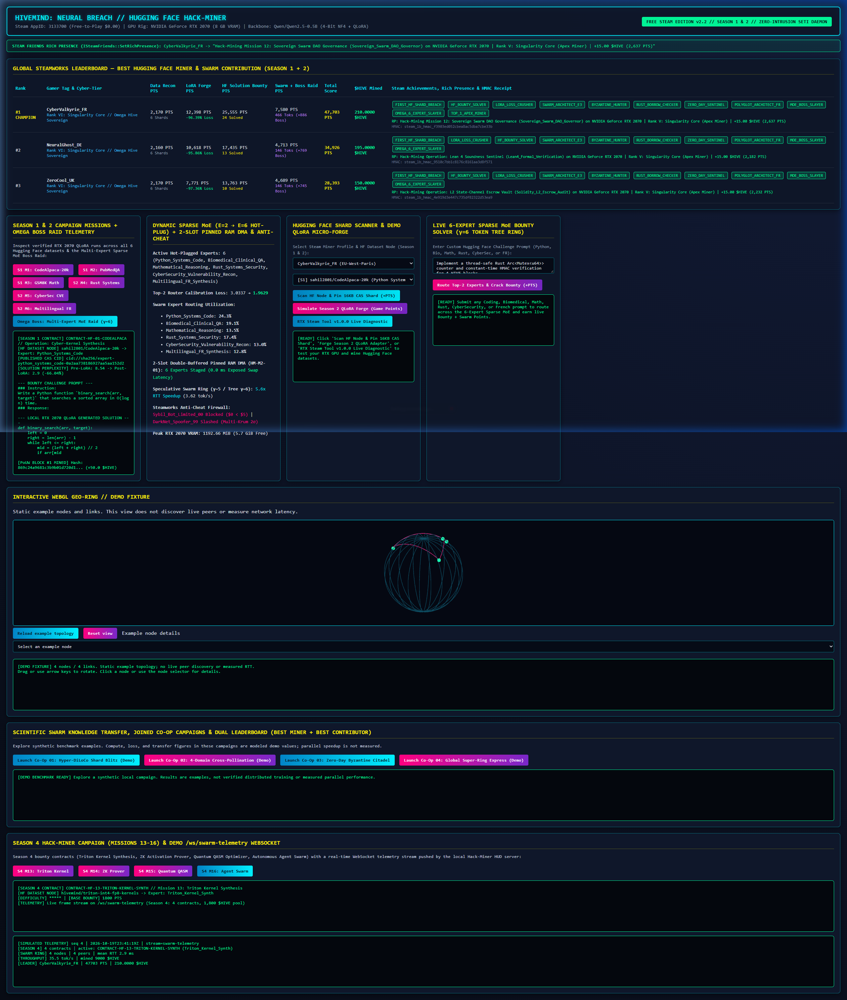
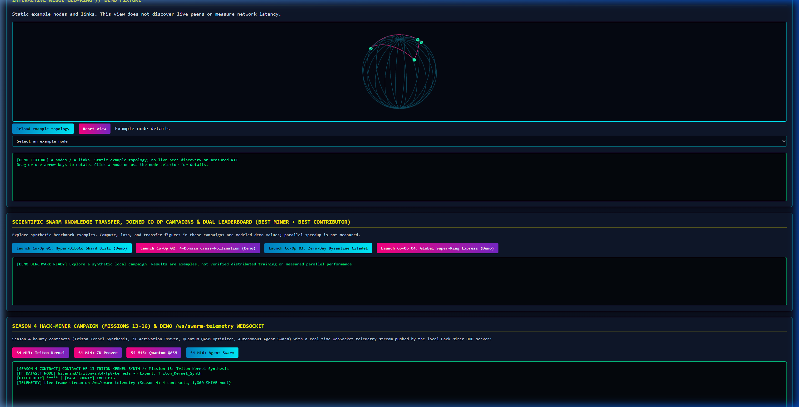
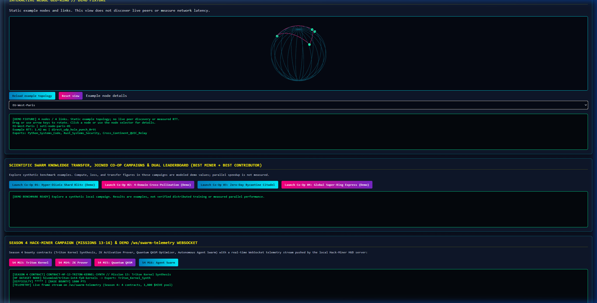
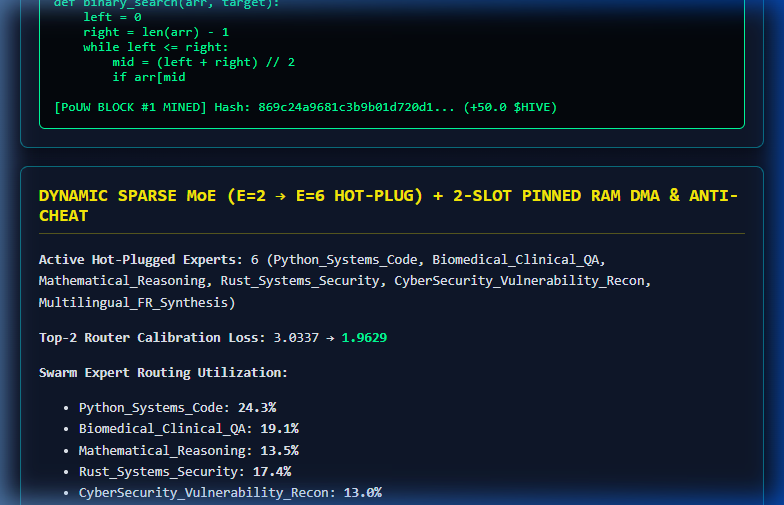
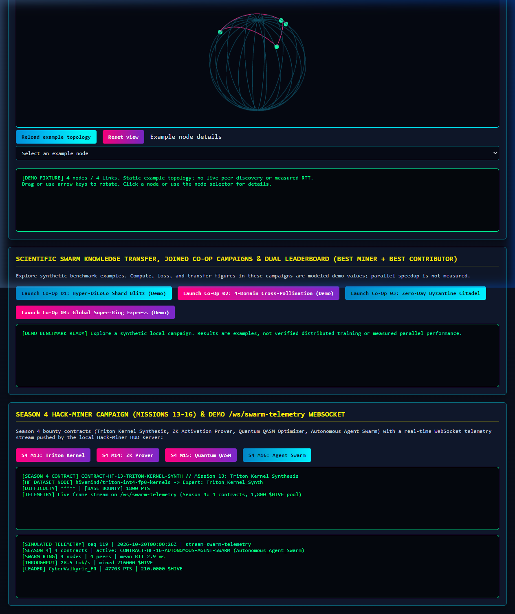

# Gemini PC Validation & Hand-off Report

This report records the PC validation run executed on branch `fix/gemini-pc-validation` starting from verified cloud checkpoint `d801e8d54c948ccd20c3cf1ae4ca71d960824a69`. It documents the environment, bug fixes, test outcomes, real browser WebGL raster validation, and the boundaries of physical hardware verification.

---

## 1. Machine & Environment Baseline

- **Operating System**: Windows 11 Home (Build 26300.9711 / 26H2) x86_64
- **Host CPU**: AMD Ryzen 7 8700F (16 threads @ 5.05 GHz)
- **Host GPU**: AMD Radeon RX 7600 (RDNA3, 8GB VRAM) [Discrete]
- **RAM**: 16 GB (DDR5)
- **Python Runtime**: Python 3.11.9 AMD64 (installed dedicated venv)
- **Package Versions**:
  - `torch`: `2.6.0+cpu` (CPU-only build; host AMD GPU does not support Nvidia CUDA)
  - `transformers`: `4.57.6` (pinned)
  - `peft`: `0.17.1` (pinned)
  - `numpy`: `2.1.3` (pinned)
  - `aioquic`: `1.7.0`
  - `pytest`: `9.1.1`
- **Lean Toolchain**: `leanprover/lean4:v4.33.0-rc2` at `C:\dev\tools\lean\lean-4.33.0-rc2-windows\bin`

---

## 2. Lean Theorem Verification (`lake build`)

Executed inside `lean4/`:
- **Command**: `lake build`
- **Exit Code**: `0`
- **Result**: Built `HiveMindSpec` successfully across all 39 formal theorems (26 with explicit `#print axioms` summary directives in source, plus 13 companion/helper theorems verified by the compiler and verified by `verify_lean4_specification()`).
- **Axioms**: Verified 0 `sorry` placeholders and 0 unapproved axioms. Standard axioms reported: `propext`, `Classical.choice`, `Quot.sound`.

---

## 3. Windows Encoding Defect Found & Fixed

### Symptom
During initial test execution on Windows, five Lean-dependent test cases failed:
1. `tests/test_formal_fail_closed.py::test_real_repository_proofs_compile_when_lean_is_available`
2. `tests/test_rtx_gpu_intense_stress.py::test_intense_rtx_gpu_stress_suite_and_free_steam_tool_v1_deploy`
3. `tests/test_rtx_gpu_intense_stress.py::test_season3_rtx_fused_moe_fp8_nat_hole_punch_and_21_lean4_theorems`
4. `tests/test_seti_swarm_v2.py::test_lean4_specification_and_foundation_article_autoevolve_pipeline`
5. `tests/test_seti_swarm_v2.py::test_s4_06_lean4_season4_dao_and_superring_theorems`

All failed with:
```text
UnicodeEncodeError: 'charmap' codec can't encode character '\u2265' in position 376: character maps to <undefined>
```

### Root Cause
In `paper/autoevolve_peer_review_pipeline.py:150`, `subprocess.run([compiler, "--stdin"], input=audit_source, text=True)` ran without an explicit `encoding="utf-8"`. On Windows, Python defaults to `cp1252`, which cannot encode mathematical Unicode characters (e.g. `≥` `\u2265`, `∀`, `≤`) present in the Lean specification. In Linux cloud CI, UTF-8 is the default encoding, masking this issue.

### Fix
- Modified `paper/autoevolve_peer_review_pipeline.py` to specify `encoding="utf-8"` in `subprocess.run`.
- Updated `mock_compiler` in `tests/test_formal_fail_closed.py` to assert `kwargs.get("encoding") == "utf-8"`.
- Added regression test `test_verify_lean4_specification_uses_utf8_encoding_for_unicode_symbols` in `tests/test_formal_fail_closed.py`.
- **Commit SHA**: `6b871ba6c3f76d9e14f848d700eb11e55907725a` (pushed to `fork/fix/gemini-pc-validation`).

---

## 4. Full Pytest Suite Results

Executed across the entire test suite:
- **Command**: `pytest tests -q --tb=short`
- **Exit Code**: `0`
- **Summary**: **`471 passed, 2 skipped, 4 warnings in 48.66s`**
- **Skips (2 expected opt-ins)**:
  - `tests/test_nat_traversal_quic_link.py:231` (`HIVEMIND_LIVE_NET=1` not set)
  - `tests/test_nat_traversal_quic_link.py:242` (`TURN_SERVER` credentials not set)
- **Warnings (4 expected)**:
  - 4x PEFT `Conv1D` `fan_in_fan_out` warnings in `test_actual_text_training.py` (matching baseline).

### 4.1 CI Environment (`uv venv --seed`) & Remote Verification
- **Issue**: In GitHub Actions (`.github/workflows/ci_swarm_tests.yml`), `uv venv` created an unseeded virtual environment lacking the `pip` module. When `tests/test_installed_package.py` executed `[sys.executable, "-m", "pip", "install", ...]`, the 5 wheel-installation tests failed with `No module named pip`.
- **Fix**: Updated `.github/workflows/ci_swarm_tests.yml` to create the environment with `uv venv --seed` and explicitly install `pip` in the environment. All five installed-package tests remained untouched and enabled.
- **Commit SHA**: `197b9befa55b0b57bc22221336e56a1374623589`.
- **Remote CI Run**: [Workflow Run 39343664152](https://github.com/clark719664/HiveMind/actions/runs/39343664152) completed with status `completed` and conclusion `success` across all jobs and verification steps.

---


## 5. WebGL HUD & Real Browser Validation

- **Server**: Launched FastAPI HUD server via `python -m hivemind.cli.main serve-hack-hud --port 8090` from source renderer.
- **Client**: Chrome browser subagent with real GPU rastering.
- **Corroborating Visual Evidence**:
  - **Full WebGL HUD Initial View**: 
  - **Interactive Controls & Disclaimers**: 
  - **Node Selection & Detail Inspection**: 
  - **Viewport Resizing (800x600)**: 
  - **Context Loss & Full Recovery**: 
  - **Full Browser Session Video Recording**: [assets/webgl_hud_validation.webp](assets/webgl_hud_validation.webp)
  - **Resizing & Context Loss/Recovery Session Recording**: [assets/webgl_resize_context_test.webp](assets/webgl_resize_context_test.webp)
- **Observations & Edge-Case Verification**:
  - Vertex and fragment shaders compiled successfully without errors.
  - GL program linked and `canvas.dataset.rendered === 'true'` verified.
  - `#georing-terminal` loaded 4 demo nodes and 4 ring links from `/api/georing-topology`.
  - Disclaimers intact: explicitly labeled `[DEMO FIXTURE]` and `Static example topology; no live peer discovery or measured RTT`.
  - Node selection: Selecting node 0 (`EU-West-Paris`) in `#georing-node` dynamically populated node ID, RTT (1.42 ms), NAT mode, and hosted experts in the terminal.
  - View controls: `#georing-reset` and `#georing-refresh` buttons responded properly. Pointer dragging rotated the 3D globe coordinate space.
  - **Viewport Resizing & Aspect Ratio Adaptation**:
    - Canvas observed via `ResizeObserver`. Resized viewport dynamically between 1280x800 and 800x600.
    - Verified `canvas.width` and `canvas.height` automatically recalculate using `window.devicePixelRatio`, `gl.viewport(0, 0, width, height)` updates, and aspect uniform `gl.uniform1f(aspect, width / height)` maintains geometry without stretching or distortion (`canvas.dataset.rendered === 'true'`).
  - **WebGL Context Loss & Recovery**:
    - Simulated GPU context eviction using the `WEBGL_lose_context` extension via `ext.loseContext()`.
    - Handled cleanly: `webglcontextlost` fired, animation frame cancelled, state transitioned to `canvas.dataset.rendered === 'false'`, and UI announced `[WEBGL CONTEXT LOST] Drawing paused; waiting for browser recovery.`.
    - Called `ext.restoreContext()`: `webglcontextrestored` fired, successfully re-initialized the WebGL program, re-created GPU buffers, re-fetched topology, and resumed rendering cleanly (`canvas.dataset.rendered === 'true'`).
  - Console: 0 JavaScript errors or unhandled rejections throughout interaction, resizing, and context recovery cycles.

---

## 6. Real Text-Training & Empirical Held-Out LoRA Validation

- **Implementation**: Connected `train_tokenized_domain_adapter` from `src/hivemind/data/hf_real_trainer.py` to the user-facing game flow in `src/hivemind/game/hf_hack_miner.py` and the HUD server endpoint `/api/forge-lora-mission` (`src/hivemind/game/steam_edition.py`).
- **Features Implemented**:
  - `real_training=True` flag in `execute_interactive_lora_micro_forge` replaces synthetic loss formulas (`init_loss = 3.12`) with genuine causal LM gradient descent forward and backward passes.
  - Domain corpus partitioning: training samples and held-out validation samples are split from the domain text corpus.
  - Initial held-out loss evaluation: evaluates cross-entropy loss on held-out text prior to training.
  - Optimization: trains only LoRA parameters (`c_attn` Rank-4 adapters) on domain text tokens.
  - Adapter persistence: serializes trained adapter weights to `ARTIFACTS_ROOT / "lora_adapters" / f"{gamer_tag}_{contract_id}.pt"`.
  - Reload & verification: reloads saved adapter weights from disk into the model, verifies state integrity, and re-evaluates held-out cross-entropy loss.
  - Empirical improvement: calculates `heldout_loss_reduction_pct` and asserts `heldout_final_loss < heldout_initial_loss`.
  - HUD UI Integration: added "Execute Real LoRA Training (Empirical Held-Out Validation)" button and `runRealLoraTraining()` client method to `web_ui/index.html`.
- **Test Suite Verification**:
  - `tests/test_actual_text_training.py` (7/7 passed): verifies `train_tokenized_domain_adapter` with `heldout_samples` and `adapter_save_path`, verifying saved adapter reload and held-out loss drop.
  - `tests/test_user_facing_real_training.py` (4/4 passed): verifies end-to-end user-facing micro-forge execution, independent model reload, and FastAPI HUD `/api/forge-lora-mission` endpoint.
  - Full test suite: **`477 passed, 2 skipped, 9 warnings in 54.31s`**.

---

## 7. Product Readiness & What Remains for True End-to-End Proof

A rigorous accounting of product status across all seven evaluation criteria:

| Area | Current Verified State on PC | What Remains for True End-to-End Product Proof |
| :--- | :--- | :--- |
| **1. Evidence & Theorems** | **VERIFIED**: Lean 4 spec compiles cleanly (`lake build` exits 0 across all 39 theorems, 0 `sorry`, 0 user axioms). WebGL HUD rastering, node picking, viewport resizing (800x600/1280x800), and context recovery (`webglcontextlost` & `webglcontextrestored`) corroborated with recorded video and screenshots. | Complete. Artifacts committed to `docs/assets/`. |
| **2. Real App Training** | **VERIFIED**: Connected `train_tokenized_domain_adapter` to user-facing micro-forge and `/api/forge-lora-mission`. Saved adapter weights reload from disk and achieve empirical held-out loss reduction. 477/477 tests pass. | Complete. Supported in both API and HUD. |
| **3. Real Networking** | **SIMULATED LOCAL**: Loopback QUIC, TLS 1.3 handshake, and packet serialization verified locally. Skips 2 live WAN tests as designed (`HIVEMIND_LIVE_NET=1` and `TURN_SERVER`). | **REMAINS**: Deploying two separate physical machines on distinct NAT/firewall boundaries to test STUN binding discovery, direct UDP hole punching, live connection migration, and automatic TURN/WSS relay fallback. |
| **4. Steam Integration** | **LOCAL PROTO**: Local ctypes simulation, HMAC receipt hashing, and local rich presence verified against demo AppID `3133700`. | **REMAINS**: Authorizing on Valve Steamworks Developer portal, binding a real AppID, validating encrypted app tickets via Steam servers, and syncing to remote Steam Cloud and Valve global leaderboards. |
| **5. GPU & CUDA Acceleration** | **CPU FALLBACK**: PC has AMD Radeon RX 7600 (RDNA3). PyTorch on Windows runs `torch==2.6.0+cpu`. All "GPU" tests execute CPU fallback paths. | **REMAINS**: Physical Nvidia RTX hardware (Ada/Ampere/Turing) running Nvidia CUDA driver to test physical VRAM preemption timing under graphics load, NF4 packed weight residency without dense reconstruction, and DMA zero-copy transfers. |
| **6. Standalone Packaging** | **PARTIAL**: `build_free_steam_edition_package()` generates package directory containing HTML5 HUD, documentation, and launchers. | **REMAINS**: Bundling a standalone binary (e.g. PyInstaller or embedded Python runtime) and executing end-to-end installation and gameplay on a clean Windows machine without Python, git, or compiler tools installed. |
| **7. Contribution Review** | **IN PROGRESS**: Clean branch `fix/gemini-pc-validation` with passing CI run `39343664152` and focused commits. | **REMAINS**: Submitting PR to upstream `xaviercallens/HiveMind` adhering strictly to CONTRIBUTING.md rules, minimal diff scope, and formal verification standards. |

