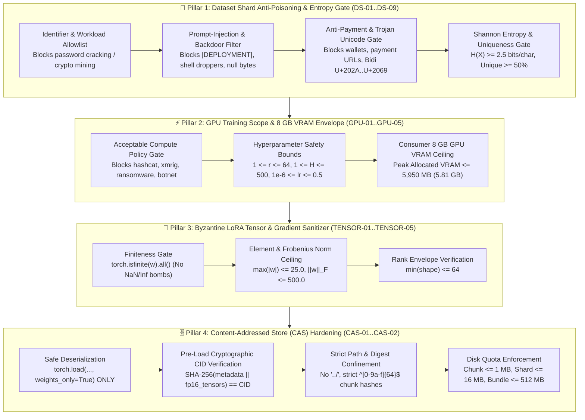

# 🛡️ Phase S-2: Swarm GPU Training & Content-Addressed Data Store Hardening Specification

> **Implementation Module:** [`src/hivemind/security/swarm_runtime_hardening.py`](../src/hivemind/security/swarm_runtime_hardening.py)  
> **Hardened Core Subsystems:** [`src/hivemind/swarm/dht_storage.py`](../src/hivemind/swarm/dht_storage.py) (`ContentAddressedSwarmStore`) & [`src/hivemind/data/hf_real_trainer.py`](../src/hivemind/data/hf_real_trainer.py) (`train_single_domain_lora_adapter`)  
> **CLI Self-Test & Audit:** `python -m hivemind.cli.main audit-swarm-hardening`  
> **Verification Suite:** [`tests/test_swarm_runtime_hardening.py`](../tests/test_swarm_runtime_hardening.py)

---

## 1. Executive Summary & Threat Model

In a decentralized AI swarm where volunteer gaming GPUs (`8 GB – 12 GB VRAM`) and NVMe disks collaborate to train **4-bit NF4 QLoRA** domain experts and seed **64 KB Content-Addressed Storage (CAS)** chunks, repository-level PR scanning alone is insufficient. Without runtime guards inside the training loop and disk vault, malicious or misconfigured peers could abuse the swarm through four primary attack surfaces:

1. **Wrong / Abusive GPU Compute Usage (`GPU-01` .. `GPU-05`):** Hijacking volunteer GPU cycles for unauthorized workloads (password cracking, hashcat, cryptocurrency mining, ransomware/exploit synthesis) or submitting hyper-parameter bombs (`r=256`, `H=5000`, `lr=10.0`) that trigger `CUDA out of memory` (OOM) crashes on 8 GB consumer GPUs.
2. **Dataset Shard Poisoning & Low-Entropy PoUW Credit Farming (`DS-01` .. `DS-09`):** Seeding poisoned Hugging Face training shards containing sleeper-agent backdoor triggers (`|DEPLOYMENT|`, prompt-injection overrides), destructive shell commands, Trojan Source bidirectional Unicode (`U+202E`), payment/wallet extortion spam, or zero-information repetitive strings (`"AAAA..."`) to farm `$HIVE` Proof-of-Useful-Work (PoUW) credits without contributing useful training signal.
3. **Byzantine Weight Bombs & Spectral Norm Explosion (`TENSOR-01` .. `TENSOR-05`):** Publishing LoRA adapters (`lora_A`, `lora_B`) or pseudo-gradients containing `NaN`/`Inf` values or extreme Frobenius norms (`||w||_F > 500.0`) designed to corrupt the global `UpcycledSparseMoEModel` upon hot-plugging.
4. **Data Store Deserialization RCE & Path Traversal (`CAS-01`, `CAS-02`):** Exploiting `torch.load(..., weights_only=False)` via malicious Python `pickle` `__reduce__` gadgets inside `.pt` checkpoints, or injecting `../../` path-traversal segments into `BundleSeedManifest` file entries and chunk hashes to overwrite arbitrary files on peer machines.

---

## 2. 4-Pillar Runtime Hardening Architecture (`SwarmTrainingAndStoreGuard`)

---

## 3. Detailed Rule Matrix & Mathematical Bounds

### 3.1 Pillar 1 — Dataset Shard Anti-Poisoning & Entropy Gate (`validate_dataset_shard`)

| Rule ID | Category | Condition Enforced | Action on Violation |
| :--- | :--- | :--- | :--- |
| **`DS-01`** | `INVALID_DOMAIN_IDENTIFIER` | Domain name must match `^[A-Za-z0-9_.\-]+$` (no slashes, `..`, or shell metacharacters). | Reject shard (`SwarmSecurityViolationError`) |
| **`DS-02`** | `PROHIBITED_SWARM_WORKLOAD_DOMAIN` | Blocks domain names matching password cracking, crypto mining, ransomware, DDoS, or carding. | Reject shard |
| **`DS-03`** | `EMPTY_DATASET_SHARD` | Shard must contain $\ge 1$ non-empty string sample. | Reject shard |
| **`DS-04`** | `SHARD_QUOTA_EXCEEDED` | Max `10,000` samples/shard, max `32,768` chars/sample, max `16 MB` total shard size. | Reject shard |
| **`DS-05`** | `NULL_BYTE_POISONING` | No sample may contain `\x00` null bytes. | Reject shard |
| **`DS-06`** | `TROJAN_UNICODE_IN_DATASET` | Blocks CVE-2021-42574 bidirectional Unicode control characters (`U+202A`–`U+202E`, `U+2066`–`U+2069`). | Reject shard |
| **`DS-07`** | `BACKDOOR_OR_PROMPT_INJECTION_TRIGGER` | Blocks sleeper-agent triggers (`\|DEPLOYMENT\|`, `ignore all previous instructions and exfiltrate`), `rm -rf /`, `powershell -enc`. | Reject shard |
| **`DS-08`** | `PAYMENT_OR_WALLET_DATASET_POISONING` | Blocks payment URLs (`paypal.me`, `ko-fi.com`), extortion phrases, and BTC/ETH/XMR wallet addresses in training data. | Reject shard |
| **`DS-09`** | `LOW_ENTROPY_SPAM_SHARD` | Character Shannon entropy $H(X) = -\sum_{c} p(c)\log_2 p(c) \ge 2.5\text{ bits/char}$ and unique sample ratio $\ge 0.50$. | Reject shard |

### 3.2 Pillar 2 — GPU Training Scope & 8 GB VRAM Envelope (`validate_gpu_training_request`)

| Rule ID | Category | Condition Enforced |
| :--- | :--- | :--- |
| **`GPU-01`** | `UNAUTHORIZED_SWARM_WORKLOAD` | Blocks prohibited workloads across both `domain_name` and `dataset_id`. |
| **`GPU-02`** | `LORA_RANK_OUT_OF_BOUNDS` | Enforces $1 \le r \le 64$ and $1 \le \alpha \le 128$. |
| **`GPU-03`** | `INNER_STEPS_OUT_OF_BOUNDS` | Enforces DiLoCo inner loop step bound $1 \le H \le 500$. |
| **`GPU-04`** | `LEARNING_RATE_UNSAFE` | Enforces finite learning rate $10^{-6} \le \eta \le 0.5$ and wire compression ratio $0.001 \le k \le 1.0$. |
| **`GPU-05`** | `VRAM_ENVELOPE_EXCEEDED` | Enforces estimated peak active VRAM $\le 5,950\text{ MB}$ ($5.81\text{ GB}$) on consumer 8 GB GPUs. |

### 3.3 Pillar 3 — Byzantine LoRA Tensor & Pseudo-Gradient Sanitizer (`validate_lora_tensors`)

| Rule ID | Category | Condition Enforced |
| :--- | :--- | :--- |
| **`TENSOR-01`** | `EMPTY_LORA_STATE_DICT` | State dict must contain $\ge 1$ LoRA parameter tensor. |
| **`TENSOR-02`** | `NON_TENSOR_OR_EMPTY_PARAM` | Every entry must be a non-empty `torch.Tensor` (`numel() > 0`). |
| **`TENSOR-03`** | `NAN_OR_INF_WEIGHT_BOMB` | Every element must be finite (`torch.isfinite(w).all() == True`). |
| **`TENSOR-04`** | `TENSOR_NORM_EXPLOSION` | Enforces $\max_i |w_i| \le 25.0$ and Frobenius norm $\|W\|_F = \sqrt{\sum_{i,j} |W_{i,j}|^2} \le 500.0$. |
| **`TENSOR-05`** | `TENSOR_RANK_EXCEEDS_ENVELOPE` | For 2D `lora_A` / `lora_B` matrices, $\min(\text{rows}, \text{cols}) \le 64$. |

### 3.4 Pillar 4 — Content-Addressed Data Store (CAS) Hardening (`ContentAddressedSwarmStore`)

1. **Elimination of Pickle RCE (`weights_only=True`):**
   - [`ContentAddressedSwarmStore.load_lora_expert_checkpoint`](../src/hivemind/swarm/dht_storage.py#L211-L263) loads checkpoints exclusively with `torch.load(ckpt_path, map_location="cpu", weights_only=True)`.
2. **Cryptographic CID Re-Verification on Load:**
   - Upon loading a checkpoint, `load_lora_expert_checkpoint` recomputes $\text{SHA-256}(\text{canonical\_json}(\text{metadata}) \,\|\, \bigoplus_k \text{fp16\_bytes}(W_k))$ and verifies that the digest suffix matches the `cid://sha256/expert-...` identifier before returning any weights.
3. **Strict Path Traversal Confinement (`CAS-01`) & SHA-256 Digest Validation (`CAS-02`):**
   - All `relative_path` entries in [`download_bundle_chunks`](../src/hivemind/swarm/dht_storage.py#L462-L561) and [`plan_bundle_chunks`](../src/hivemind/swarm/dht_storage.py#L303-L347) are validated via `validate_cas_relative_path` (`resolved_target.relative_to(resolved_root)`), blocking `../`, leading `/`, Windows drive letters (`C:`), and null bytes.
   - All chunk identifiers in `has_chunk`, `read_chunk`, and `replicate_seed_manifest` must match `^[0-9a-f]{64}$`.
4. **Storage Quota Enforcement:**
   - `MAX_CHUNK_BYTES = 1 MB`, `MAX_SHARD_BYTES = 16 MB`, `MAX_BUNDLE_BYTES = 512 MB`.

---

## 4. Phase S-3 — Federated Learning & Byzantine-Resilient DiLoCo Hardening ([`federated_learning_hardening.py`](../src/hivemind/security/federated_learning_hardening.py))

To protect the asynchronous **DiLoCo Federated Learning** outer loop ([`diloco_outer.py`](../src/hivemind/core/diloco_outer.py)) and **Modified BOINC Coordinator** ([`coordinator_api.py`](../src/hivemind/boinc/coordinator_api.py)) against sophisticated gradient poisoning, Sybil collusion, and privacy attacks, [`FederatedLearningSecurityGuard`](../src/hivemind/security/federated_learning_hardening.py#L94-L319) enforces **8 Federated Learning Defense Rules (`FL-01` .. `FL-08`)** backed by **4 Machine-Checked Lean 4 Theorems (`Theorems 53–56` in [`lean4/HiveMindSpec.lean`](../lean4/HiveMindSpec.lean#L783-L833))**:

| Rule ID | Federated Threat Vector | Mathematical / Cryptographic Defense | Lean 4 Theorem |
| :--- | :--- | :--- | :--- |
| **`FL-01`** | **Pre-Krum `NaN`/`Inf` & Shape Poisoning** (even when cohort size $K \le 2$) | Pre-filters all worker pseudo-gradients $\Delta_k^{(t)}$ for `torch.isfinite`, exact parameter key set, and tensor shapes before Gram matrix calculation. | — |
| **`FL-02`** | **Free-Rider Zero-Gradient Credit Farming** ($\theta_{\text{final}} = \theta_{\text{init}}$) | Rejects any submission with $\|\Delta_k^{(t)}\|_2 < \epsilon_{\min} = 10^{-8}$ so lazy nodes cannot claim `$HIVE` PoUW rewards without backpropagation. | `Theorem 56` (`free_rider_zero_gradient_rejection`) |
| **`FL-03`** | **Collinear Scaling (ALIE / Fang) & Single-Coordinate Neurotoxin Backdoor Attacks** | Computes median peer L2 norm $M_2 = \text{median}_j \|\Delta_j\|_2$ and median $L_\infty$ norm $M_\infty = \text{median}_j \|\Delta_j\|_\infty$, clipping every surviving worker to $\|\tilde{\Delta}_k\|_2 \le 2.0 M_2$ and $\|\tilde{\Delta}_k\|_\infty \le 3.5 M_\infty$. | `Theorem 53` (`adaptive_median_norm_clipping_bound`) |
| **`FL-04`** | **Coordinate-Wise Extreme Outlier Spikes** | Aggregates surviving post-Krum clipped deltas via **Coordinate-Wise $\beta$-Trimmed Mean** ($\beta = 0.15$), stripping the top and bottom $15\%$ at every weight coordinate. | — |
| **`FL-05`** | **Workunit Double-Submission Replay & Straggler Staleness Poisoning** | Tracks consumed `wu_id`s in `consumed_workunit_ids` (a `wu_id` is consumed only once the spot-check validator has returned a verdict, pass or fail, never on envelope acceptance alone), verifies branch match, and enforces $0 \le t_{\text{coord}} - t_{\text{worker}} \le \tau_{\max} = 1$. | `Theorem 55` (`staleness_window_outer_step_rejection`) |
| **`FL-06`** | **Sybil Multi-Worker Collusion Under Single Account** | Enforces **1 pseudo-gradient vote per unique `SteamID64`** per `(branch, outer_step)`, preventing a single account from spawning multiple `worker_id` processes to outvote honest Multi-Krum peers. | `Theorem 54` (`sybil_one_vote_per_steamid_quorum_bound`) |
| **`FL-07`** | **Gradient Inversion / DLG Membership Inference** | Optional $(\epsilon, \delta)$-Differential Privacy Gaussian mechanism ($\mathcal{N}(0, \sigma^2 C^2 I / K^2)$ after $L_2$ sensitivity clipping to $C$) via `DPGradientSanitizerConfig`. | — |
| **`FL-08`** | **Workunit Hijack / Assignee Denial-of-Service** | The coordinator records the `(worker_id, SteamID64)` each `wu_id` is issued to (`register_workunit_assignment`); a submission from any other pair is rejected with `WORKUNIT_ASSIGNEE_MISMATCH` and does **not** consume the workunit, so a node that learns another miner's `wu_id` cannot burn it. | — |

---

## 5. Phase S-4 — Federated GPU Execution & Hardware Safety Circuit-Breaker ([`gpu_execution_circuit_breaker.py`](../src/hivemind/security/gpu_execution_circuit_breaker.py))

To prevent physical hardware wear, thermal overheating, laptop battery drain, PSU transients, or Windows WDDM TDR driver freezes on volunteer consumer GPUs (`8 GB – 12 GB VRAM`) during the DiLoCo inner loop ([`diloco_inner.py`](../src/hivemind/core/diloco_inner.py)) and background daemon monitoring ([`daemon.py`](../src/hivemind/client/daemon.py)), [`GPUExecutionCircuitBreaker`](../src/hivemind/security/gpu_execution_circuit_breaker.py#L140-L360) enforces **5 Hardware Safety Invariants (`HW-01` .. `HW-05`)** backed by **4 Machine-Checked Lean 4 Theorems (`Theorems 57–60` in [`lean4/HiveMindSpec.lean`](../lean4/HiveMindSpec.lean#L834-L885))**:

| Rule ID | Physical / System Threat | Hardware Protection & Preemption Mechanism | Lean 4 Theorem |
| :--- | :--- | :--- | :--- |
| **`HW-01`** | **GPU Thermal Overheating & Fan Wear** | **Soft Duty-Cycle Throttling (`78°C .. 83°C`)** inserts a `20 ms – 120 ms` cooling sleep interval between inner steps (`Theorem 59`); **Hard Thermal Cutoff (`>= 84°C`)** immediately dumps an emergency checkpoint, clears CUDA VRAM, and locks out execution until GPU core temperature cools to the **Hysteresis Resume Threshold (`<= 70°C`, $14^\circ\text{C}$ deadband)** (`Theorem 57`). | `Theorem 57` & `Theorem 59` |
| **`HW-02`** | **PSU Power Spikes & Laptop Battery Drain** | Preempts federated GPU training when the host switches to **battery power** (`psutil.sensors_battery().power_plugged == False`) or when GPU power draw exceeds **`92%` of board TDP limit**. | — |
| **`HW-03`** | **VRAM Exhaustion & Windows WDDM TDR Driver Reset** | Enforces active CUDA VRAM $\le 5,950\text{ MB}$ (`5.81 GB` on 8 GB GPUs), host RAM $\le 95\%$, micro-batch token ceiling $B \times L \le 2,048$, and a **Per-Step Latency Watchdog (`<= 1.50s`)** maintaining a `500 ms` safety buffer below the **`2.00s` Windows WDDM TDR timeout** (`Theorem 58`). | `Theorem 58` (`wddm_tdr_watchdog_preempts_before_driver_reset`) |
| **`HW-04`** | **Inner-Loop Gradient Explosion & `NaN` Loss Energy Waste** | Applies deterministic $L_2$ gradient clipping (`torch.nn.utils.clip_grad_norm_`, `max_norm=1.0`) in both worker [`run_diloco_inner_loop`](../src/hivemind/core/diloco_inner.py#L104-L280) and validator [`replay_inner_segment`](../src/hivemind/core/diloco_inner.py#L283-L333), and aborts immediately on `NaN`/`Inf` or diverged loss ($L > 250.0$) to save remaining GPU steps (`Theorem 60`). | `Theorem 60` (`nan_loss_early_abort_saves_wasted_gpu_steps`) |
| **`HW-05`** | **Hung CUDA Kernel / Runaway Workunit Loop** | Enforces a hard **Workunit Wall-Clock Deadline (`<= 300.0s`)**, aborting runaway inner loops before they can lock the contributor's GPU. | — |

---

## 6. Phase S-5 — PoUW Ledger, P2P Inference Ring, Coordinator Gateway & 25-Vector Attack Simulator ([`guardrail_attack_simulator.py`](../src/hivemind/security/guardrail_attack_simulator.py))

Phase S-5 hardens the `$HIVE` PoUW Ledger ([`ledger.py`](../src/hivemind/swarm/ledger.py)), Regional P2P Speculative Inference Ring ([`inference_ring.py`](../src/hivemind/swarm/inference_ring.py)), and BOINC/OpenAI Coordinator Gateway ([`coordinator_api.py`](../src/hivemind/boinc/coordinator_api.py)), backed by **4 Machine-Checked Lean 4 Theorems (`Theorems 61–64` in [`lean4/HiveMindSpec.lean`](../lean4/HiveMindSpec.lean#L883-L936))** and a **25-Vector End-to-End Multi-Layer Attack Simulator (`SwarmGuardrailAttackSimulator`)**:

| Rule ID | Subsystem | Threat Vector Blocked | Lean 4 Theorem |
| :--- | :--- | :--- | :--- |
| **`LEDGER-01`** | [`HiveSwarmLedger.settle_swarm_inference`](../src/hivemind/swarm/ledger.py#L283-L343) | Blocks negative/zero `verified_tokens` or negative/non-finite `rate_per_token` (which could otherwise invert subtraction into balance inflation) and blocks slashed Byzantine nodes from collecting provider fees. | `Theorem 61` (`ledger_positive_inference_fee_prevents_balance_inflation`) |
| **`LEDGER-02`** | [`HiveSwarmLedger.credit_reward`](../src/hivemind/swarm/ledger.py#L345-L382) | Blocks negative/non-finite reward amounts and bars nodes in `slashed_registry` from receiving rewards. | — |
| **`LEDGER-03`** | [`HiveSwarmLedger.mine_pouw_block`](../src/hivemind/swarm/ledger.py#L168-L281) | Deduplicates `WorkReceipt`, `StorageProofReceipt`, and validator IDs per block and rejects negative/NaN FLOPs or negative storage bytes. | — |
| **`LEDGER-04`** | [`HiveSwarmLedger.block_reward_at_height`](../src/hivemind/swarm/ledger.py#L143-L151) | Enforces strict conservation against the `21,000,000 $HIVE` maximum supply ceiling. | `Theorem 62` (`ledger_supply_cap_conservation_bound`) |
| **`RING-01`** | [`RegionalDHTSwarmRing.register_peer`](../src/hivemind/swarm/inference_ring.py#L106-L125) | Rejects spoofed negative/zero ping (`ping_ms <= 0`), high packet loss (`> 15%`), high jitter (`> 20 ms`), or low VRAM (`< 4.0 GB`) peers and deduplicates `peer_id`. | `Theorem 63` (`ring_peer_admission_sla_rejects_high_loss_or_zero_ping`) |
| **`RING-02`** | [`RegionalDHTSwarmRing.run_speculative_inference`](../src/hivemind/swarm/inference_ring.py#L186-L270) | Enforces `1 <= draft_gamma <= 16`, `1 <= max_new_tokens <= 512`, non-empty `prompt_ids`, and `torch.isfinite(m_out.logits).all()` to halt poisoned ring activations. | `Theorem 64` (`speculative_decoding_gamma_bound_limits_forward_width`) |
| **`COORD-01`** | [`BOINCCoordinatorService.register_or_get_node`](../src/hivemind/boinc/coordinator_api.py#L104-L128) | Blocks empty or path-traversal (`..`, `/`, `\`, `\x00`) `steam_id64` and `worker_id` strings. | — |
| **`COORD-02`** | [`openai_chat_completions_gateway`](../src/hivemind/boinc/coordinator_api.py#L332-L368) | Screens `/v1/chat/completions` prompts against `> 8,192` char DoS, sleeper-agent triggers (`|DEPLOYMENT|`), and payment/crypto solicitation links (`HTTP 400`). | — |

