# 🗺️ Project HiveMind — Master Engineering Roadmap & Peer Development Plan

> **Steam status:** The Hack-Miner is a local prototype. The previously advertised App ID belongs to another product; see [Steam integration status](docs/STEAM_STATUS.md). Leaderboards and cloud saves on `main` are local simulations, not verified Valve services.

> **Mission:** Transform millions of idle consumer gaming GPUs (**8 GB–12 GB VRAM**) and local NVMe drives into a verifiable, Byzantine-fault-tolerant **Sparse Mixture-of-Experts (MoE)** training and inference supercomputer.

```mermaid
flowchart LR
    subgraph P1["✅ Phase 1: Core Pillars & RTX 2070 PoC (COMPLETE)"]
        A1["Zero-Copy 4-Bit NF4 + DiLoCo-QLoRA\n(175.96 MB Base, 3.33x FP8 Wire)"]
        A2["Byzantine Defense\n(10% Spot-Check + Multi-Krum 2σ)"]
        A3["Factored BTM Sparse MoE Upcycling\n(96 Experts in 1,527 MiB VRAM)"]
        A4["SETI Daemon + CAS Vault + $HIVE Ledger\n(<1.5s Game Yield, 21M Cap)"]
    end

    subgraph P2["⚡ Phase 2: 'Swarm Fabric' & Steam Edition (v2.1 LIVE / SCALING)"]
        B1["M1: Kademlia XOR DHT & Sub-20ms\nRegional Geo-Rings (aioquic/Libp2p)"]
        B2["M2: 3-Tier NVMe -> Pinned RAM -> VRAM\nAsync DMA (0ms Swap) + Macro/Micro Router"]
        B3["M3: Eagle/Medusa Token Tree Speculation\n(γ=6) + FP8 Hidden-State Wire"]
        B4["M4: OpenAI /v1/chat/completions Proxy\n+ 5% OPoI Audits + L2 $HIVE Channels"]
        B5["M5: HiveMind: Neural Breach\nLocal Hack-Miner Prototype"]
    end

    subgraph P3["🚀 Phase 3: Global WAN Scale-Out (OPEN FOR CONTRIBUTORS)"]
        C1["Cross-Continent Hierarchical MoE\n(64–256 Domain Experts, 70B+ Active)"]
        C2["Native Triton FP8 Kernels & C++\nSteamworks Overlay DLL"]
        C3["Zero-Knowledge / Merkle Dispute Game\n& Decentralized Hugging Face Hub Sync"]
    end

    P1 --> P2 --> P3
```

---

## ✅ Phase 1 — The 4 Core Pillars & Local 8 GB RTX 2070 PoC (Completed & Verified)

All Phase 1 components are implemented, benchmarked on a local **NVIDIA GeForce RTX 2070 (8 GB VRAM, Turing SM 7.5)**, and covered by our automated test suite:

- [x] **Pillar 1 — Zero-Copy 4-Bit NF4 + DiLoCo-QLoRA (`500x` Bandwidth Reduction):**
  - Meta-device skeleton initialization + streaming safetensors directly to `cuda:0` (`175.96 MB` packed NF4 footprint for `Qwen/Qwen2.5-0.5B`, `0 bytes` CPU heap duplication).
  - Top-$k$ sparsification + `float8_e4m3fn` pseudo-gradient delta compression (`16.78 MB -> 5.04 MB`, `3.33x` wire reduction).
- [x] **Pillar 2 — Byzantine Fault Tolerance Without 2x Redundancy Waste:**
  - Bitwise deterministic micro-checkpointing (`CUBLAS_WORKSPACE_CONFIG=:4096:8`) with 10% random segment replay ($\epsilon \le 10^{-4}$, measured `max_diff = 0.0`).
  - Multi-Krum $2\sigma$ cosine similarity outer filtering + Nesterov outer momentum ($\mu = 0.9, \eta = 0.7$).
- [x] **Pillar 3 — Factored In-Place Sparse MoE Upcycling (BTM Phase C):**
  - In-place self-attention LoRA merging + factored SwiGLU FFN expert upcycling (`96` experts, `1.44B` logical parameters running in `1,527.03 MiB` peak VRAM — leaving `5.63 GB` free on an 8 GB card).
  - Mixed-precision Top-2 softmax gating router ($W_g$ in `FP32` to prevent AdamW underflow, experts in `FP16`), converging from `2.1284 -> 0.7774`.
- [x] **Pillar 4 — SETI-Swarm Lifecycle, CAS Disk Vault & `$HIVE` PoUW Ledger:**
  - Win32 `GetLastInputInfo` + process monitor yielding 100% of VRAM in `< 1.5s` (`21.6 ms` measured).
  - Content-Addressed Swarm Store (`cid://sha256/...`) with Merkle byte-range Proof-of-Storage audits.
  - Bitcoin-inspired `$HIVE` ledger (`21,000,000` max supply, `60% / 15% / 15% / 10%` reward split, automatic Byzantine slashing).

---

## ⚡ Phase 2 — "Swarm Fabric" (M1–M4) & local Hack-Miner prototype (M5)

The core Phase 2 **Swarm Fabric** engine (`src/hivemind/swarm/swarm_fabric.py`) and **Local Hack-Miner Prototype** (`src/hivemind/game/`) are implemented and verified (`16/16` passing tests). We are actively scaling out with community contributors across five tracks:

### Milestone M1: Sub-20ms Regional Geo-Ring Transport (`feat/m1-*`)
- [x] **Core Implemented:** `RegionalGeoRingTransport` with 160-bit Kademlia XOR distance routing and `<20 ms` regional peer admission (`src/hivemind/swarm/swarm_fabric.py`).
- [ ] **Open Contributor Task [`HM-M1-01`](docs/CONTRIBUTOR_TASKS_AND_BOUNTIES.md#task-hm-m1-01-native-aioquic-http3-0-rtt--libp2p-websocket-nat-hole-punching):** Native `aioquic` HTTP/3 0-RTT datagrams & Libp2p WebSocket NAT hole-punching (`STUN/TURN/ICE`).
- [ ] **Open Contributor Task [`HM-M1-02`](docs/CONTRIBUTOR_TASKS_AND_BOUNTIES.md#task-hm-m1-02-kademlia-dht-gossipsub-live-expert-table--regional-failover):** Kademlia GossipSub live expert routing table & `<25 ms` hot-standby failover when a peer launches a Steam game.

### Milestone M2: 3-Tier NVMe $\rightarrow$ Pinned RAM $\rightarrow$ VRAM Memory & Macro/Micro Router (`feat/m2-*`)
- [x] **Core Implemented:** `PinnedRAMExpertDMAStreamer` (`pin_memory` + dedicated non-blocking `torch.cuda.Stream` achieving `0.0 ms` exposed swap latency) & `TwoLevelMacroMicroRouter` ($G_{\text{macro}} \rightarrow G_{\text{micro}}$ in `FP32`).
- [ ] **Open Contributor Task [`HM-M2-01`](docs/CONTRIBUTOR_TASKS_AND_BOUNTIES.md#task-hm-m2-01-double-buffered-cuda-stream-lookahead-prefetcher):** Double-buffered CUDA stream lookahead prefetcher overlapping layer $L+1$ expert DMA with layer $L$ self-attention.
- [ ] **Open Contributor Task [`HM-M2-02`](docs/CONTRIBUTOR_TASKS_AND_BOUNTIES.md#task-hm-m2-02-zero-copy-mmap-nvme-to-pinned-ram-lru-cache):** Zero-copy `safetensors` `mmap` NVMe-to-Pinned-RAM LRU ring buffer for 64+ domain experts on 8 GB GPUs.

### Milestone M3: Eagle/Medusa Token Tree Speculation & FP8 Wire Kernels (`feat/m3-*`)
- [x] **Core Implemented:** `TokenTreeSpeculativeVerifier` ($\gamma = 6$ tree verification) and `compress_hidden_states_fp8` / `decompress_hidden_states_fp8` (`float8_e4m3fn` `2.0x` wire reduction).
- [ ] **Open Contributor Task [`HM-M3-01`](docs/CONTRIBUTOR_TASKS_AND_BOUNTIES.md#task-hm-m3-01-custom-triton-float8_e4m3fn-quantization-kernel--dynamic-speculative-tree-attention):** Custom Triton `float8_e4m3fn` group-quantization kernel & 2D causal tree-attention mask for multi-branch verification in a single MoE pass.

### Milestone M4: OpenAI `/v1/chat/completions` Gateway, OPoI 5% Audits & Layer-2 `$HIVE` Channels (`feat/m4-*`)
- [x] **Core Implemented:** `OptimisticProofOfInferenceAuditor` (probabilistic 5% cosine activation audit), `HiveLayer2StateChannel` (HMAC micro-vouchers + batch L1 settlement), and `POST /v1/chat/completions` in `src/hivemind/boinc/coordinator_api.py`.
- [ ] **Open Contributor Task [`HM-M4-01`](docs/CONTRIBUTOR_TASKS_AND_BOUNTIES.md#task-hm-m4-01-streaming-sse-streamtrue-v1chatcompletions-proxy-for-cursor--continuedev):** Streaming SSE (`stream=True`) support on `/v1/chat/completions` for live integration with Cursor, Continue.dev, and Cline.
- [ ] **Open Contributor Task [`HM-M4-02`](docs/CONTRIBUTOR_TASKS_AND_BOUNTIES.md#task-hm-m4-02-merkle-proof-fraud-dispute-game-for-optimistic-proof-of-inference-opoi):** Merkle-proof activation dispute game & automated L2 escrow slashing.

### Milestone M5: `HiveMind: Neural Breach` Local Hack-Miner Prototype & Hugging Face Domains (`game/*`, `expert/*`)
- [x] **Core Implemented:** Playable 3-Mission Hugging Face Hack-Miner (`CodeAlpaca-20k`, `PubMedQA`, `GSM8K`) + Final Boss 3-Expert Sparse MoE Speculative Raid (`5.60x` RTT speedup), simulated Steam $5/VAC checks, HMAC Leaderboard receipts, and Cyberpunk Web HUD (`http://127.0.0.1:8090`).
- [ ] **Open Contributor Task [`HM-M5-01`](docs/CONTRIBUTOR_TASKS_AND_BOUNTIES.md#task-hm-m5-01-native-steam_api64dll-bridge--live-steam-rich-presence):** Native `steam_api64.dll` / `libsteam_api.so` ctypes wrapper for live Steam Overlay & Friends Rich Presence.
- [ ] **Open Contributor Task [`HM-M5-02`](docs/CONTRIBUTOR_TASKS_AND_BOUNTIES.md#task-hm-m5-02-season-2-hugging-face-domain-expert-bounties):** Season 2 Hugging Face Domain Expert Missions (`Rust_Systems`, `CyberSecurity`, `Legal_Contracts`, `Multilingual_FR/ES`).

---

## 🤝 How to Join Peer Development

1. Read **[`CONTRIBUTING.md`](CONTRIBUTING.md)** for branch naming rules (`feat/m1-*`, `feat/m2-*`, `expert/*`, `game/*`), the 8 GB VRAM ceiling, and PR review guidelines.
2. Pick an open task from **[`docs/CONTRIBUTOR_TASKS_AND_BOUNTIES.md`](docs/CONTRIBUTOR_TASKS_AND_BOUNTIES.md)** or [GitHub Issues](https://github.com/xaviercallens/HiveMind/issues).
3. Help spread the word using our **[Community & Social Media Kit (`docs/SOCIAL_MEDIA_KIT.md`)](docs/SOCIAL_MEDIA_KIT.md)**!
